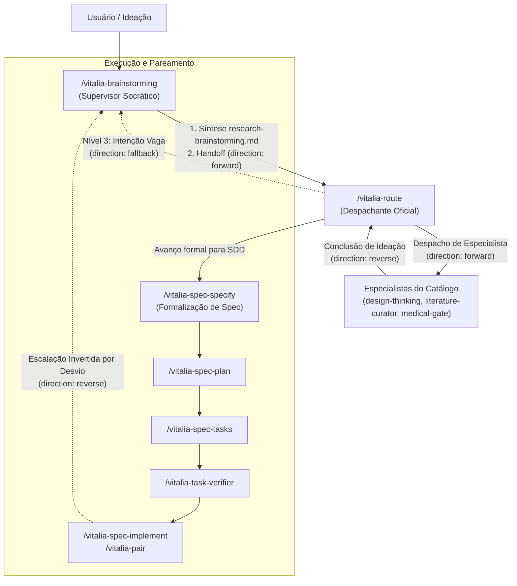

<!-- README.md | Vitalia SDD v0.6.0 | 20-10-2026 09:50(GMT-04:00) -->
> **README.md | Vitalia SDD v0.6.0 | 20-10-2026 09:50(GMT-04:00)**
# Vitalia Agent Kit — Core Source Repository

Repositório central de desenvolvimento do **Vitalia SDD Kit v0.6.0** (Spec-Driven Development), contendo os fluxos agênticos socráticos, o oráculo contextual dinâmico (**Guardian**), o barramento determinístico local de transição inter-agente (**Handoffs**) e os despachantes de workflows para IDEs de IA (Antigravity e Gemini CLI).

---

## 🏛️ Arquitetura de Roteamento e Handoffs (v0.6.0)

A arquitetura de roteamento inter-agente opera em ciclo fechado com persistência atômica no filesystem local em `.vitalia/memory/data_storage/handoffs/` (Zero Data Leak, sem dependência obrigatória de Redis):



---

## 📦 Componentes do Repositório

```
kit_src/
├── source/
│   ├── bin/install-project           # Instalador de skills e integração com IDEs
│   ├── config/schemas/               # Schemas JSON formais (ex: agents_catalog.schema.json)
│   ├── extensions/*.toml             # Definição e prompts dos workflows (.toml)
│   ├── profiles/agents_catalog.yaml  # Catálogo oficial de agentes (active & planned)
│   └── src/
│       ├── vitalia_handoff.py        # Biblioteca e CLI de handoffs atômicos locais
│       ├── vitalia_hook_runner.py    # Runtime de execução de hooks e Context Lifting
│       └── hooks/
│           ├── guardian_context.py   # Oráculo Guardian com equalização de tokens
│           └── sdd_judge.py          # Gatekeeper constitucional em 6 fases
├── specs/                            # Especificações de features do kit
└── tests/
    ├── unit/                         # Testes unitários (handoff, catálogo, escalação)
    └── integration/                  # Testes integrados (fluxo brainstorming -> route)
```

---

## 🛠️ CLI de Handoffs (`vitalia_handoff.py`)

O utilitário oferece comandos para automação e transições determinísticas:

```bash
# 1. Criar novo handoff
python3 ~/.vitalia/src/vitalia_handoff.py create \
  --source "brainstorming" \
  --target "vitalia-route" \
  --direction "forward" \
  --intent "brainstorming_to_route" \
  --input "Desenhar onboarding médico" \
  --summary "specs/kit-routing-subagents/research-brainstorming.md"

# 2. Validar payload existente contra o schema oficial
python3 ~/.vitalia/src/vitalia_handoff.py validate --file ".vitalia/memory/data_storage/handoffs/handoff_*.json"

# 3. Consumir handoff atomicamente
python3 ~/.vitalia/src/vitalia_handoff.py consume --file ".vitalia/memory/data_storage/handoffs/handoff_*.json"

# 4. Obter o último handoff pendente válido
python3 ~/.vitalia/src/vitalia_handoff.py latest --target "vitalia-route"
```

---

## 🧪 Testes Automatizados

Para executar toda a suíte de testes do kit:

```bash
source .venv/bin/activate
pytest tests/unit/ tests/integration/ -v
```
