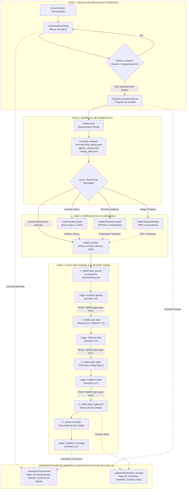
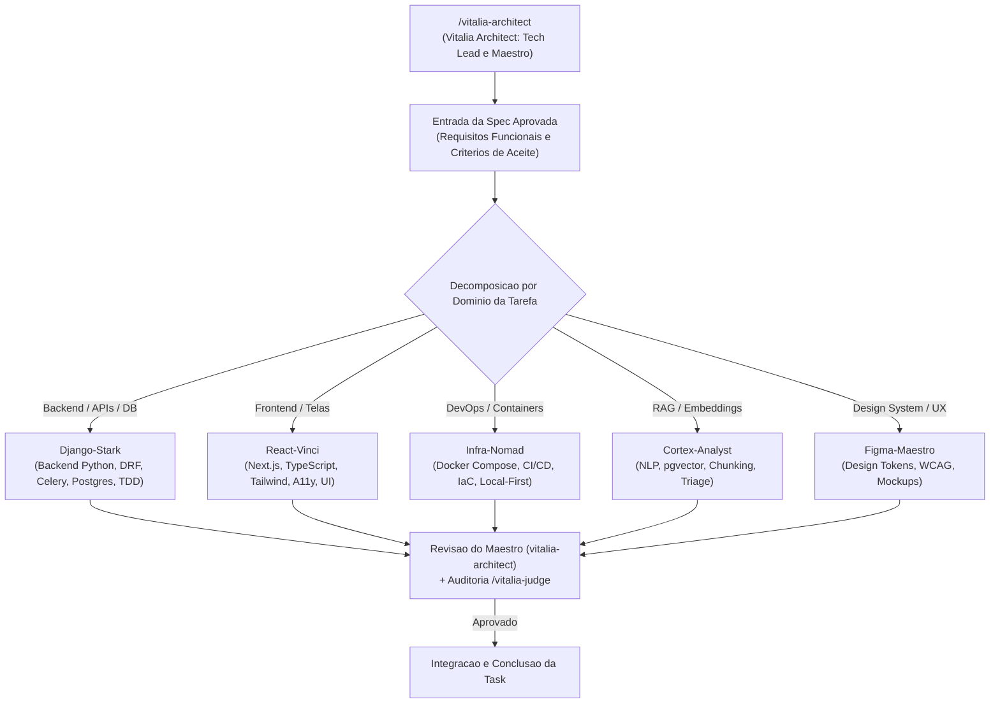

# Diagrama de Interação de Ponta a Ponta — Vitalia SPEC Kit (v0.0.1)

> **Data/Hora de Geração:** `03-11-2026 19:30:00(GMT-04:00)` | **Fuso Horário:** America/Cuiaba `(GMT-04:00)`

---

## 1. Diagrama Geral de Interação (Mermaid Puro — Tema Nativo)

---

## 2. Diagrama de Regência da Engenharia (Architect e Especialistas)

---

## 3. Tabela Sequencial do Fluxo de Trabalho

| Passo | Agente Executor | Missão Principal | Artefato Gerado / Consumido |
|---|---|---|---|
| **1. Concepção** | `/vitalia-brainstorming` | Ideação aberta e questionamento socrático em turnos de até 3 perguntas. | Gera `specs/<feature>/research-brainstorming.md`. |
| **2. Despacho** | `/vitalia-route` | Classifica a intenção e propõe ao usuário o próximo especialista. | Consome o handoff e os catálogos YAML. |
| **3. Domínio Clínico / Pesquisa** | `medical-gate` ou `literature-curator` | Valida risco de saúde ou reúne literatura científica indexada (se aplicável). | Parecer de risco (`DRAFT`) ou fichamento PRISMA. |
| **4. Maestro SDD** | `/vitalia-architect` (Vitalia Architect) | Recebe os consensos, avalia viabilidade técnica e inicia o ciclo SDD. | Abre o diretório da feature e chama `/vitalia-spec-specify`. |
| **5. Especificação** | `/vitalia-spec-specify` | Modela a spec formal com User Stories e cenários Given-When-Then. | Gera `spec.md` e checklist ISO 29148. |
| **6. Auditoria Spec** | `/vitalia-judge --mode=specify` | Avalia conformidade constitucional e ISO 29148 com Inverted CoT. | `Relatório de Inspeção - specify.md` (Pausa HITL). |
| **7. Planejamento** | `/vitalia-spec-plan` | Define arquitetura técnica e contratos de interface em OpenAPI 3.0 puro. | Gera `plan.md` e esquemas em `contracts/`. |
| **8. Auditoria Plan** | `/vitalia-judge --mode=plan` | Valida decisões técnicas e ausência de esquemas poluídos com `$schema`. | `Relatório de Inspeção - plan.md` (Pausa HITL). |
| **9. Decomposição** | `/vitalia-spec-tasks` | Decompõe o plano em tarefas atômicas (T001, T002) com Red Phase ou Bug Repro. | Gera `tasks.md`. |
| **10. Auditoria Tasks** | `/vitalia-judge --mode=tasks` | Valida atomicidade, ordem de dependência e cobertura de User Stories. | `Relatório de Inspeção - tasks.md` (Pausa HITL). |
| **11. Implementação** | `/vitalia-spec-implement` | Executa o código e valida testes verdes antes de marcar `[X]`. | Código em produção e testes unitários. |
| **12. Reconciliação** | `/vitalia-converge` | Auditoria quadridimensional entre código real, spec, plan e tasks. | Reconciliação de `tasks.md` via Sub-Agente Judge. |
