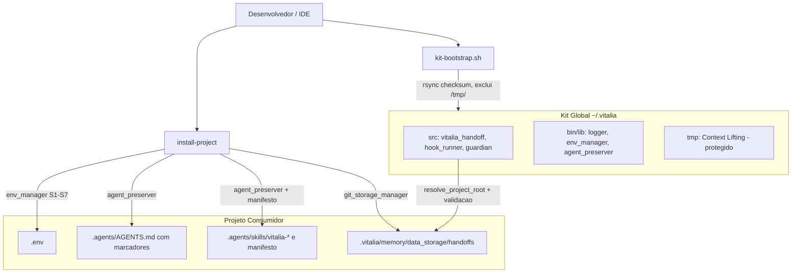
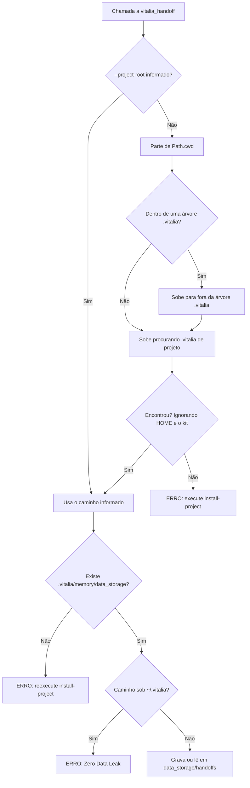

<!-- research-brainstorming.md | Vitalia SDD v0.6.0 | 31-10-2026 11:40(GMT-04:00) -->
> **research-brainstorming.md | Vitalia SDD v0.6.0 | 31-10-2026 11:40(GMT-04:00)**

# Registro de Concepção e Brainstorming: Isolamento de Memória, Governança de Instalação e Arquitetura Limpa do Kit

> [!NOTE]
> **Revisão 2 (31-10-2026 11:40):** decisões corrigidas após auditoria contra o código real (bloqueadores B1–B4 e riscos R1–R10). As correções estão marcadas com 🔧 ao longo do texto e consolidadas na Seção 6.

## 1. Resumo Executivo das Decisões Tomadas

Nesta sessão de brainstorming foi alinhada a arquitetura para:
- eliminar o vazamento de handoffs para o diretório global do usuário (`~/.vitalia/memory/`);
- corrigir fragilidades nos scripts de instalação (`kit-bootstrap.sh` e `install-project`).

Princípios atendidos: **Zero Data Leak (P02/P07/P12)**, **Clean Architecture**, **SRP** e **salvaguarda não-destrutiva de arquivos do usuário**.

---

### Decisão 1: Isolamento de Memória e Zero Data Leak (`vitalia_handoff.py`)

- **Causa raiz:** `REPO_ROOT = Path(__file__).resolve().parent.parent` aponta para `$HOME` quando o script roda de `~/.vitalia/src/`. Resultado: handoffs gravados e lidos em `~/.vitalia/memory/data_storage/handoffs/`.
- 🔧 **Resolvedor dedicado e autocontido (B1, B2, R2):** **não** reutilizar `kit_env_bootstrap.find_project_root()`.
  - Motivo comprovado em teste: a partir de `~/projetos`, ela retorna `/home/andre`, porque o próprio kit (`~/.vitalia`) conta como marcador `.vitalia`.
  - Com cwd dentro de `data_storage/` (que possui `.git`), ela retorna `data_storage` como raiz.
  - `find_project_root()` permanece **inalterada**, pois `gemini.py` e `scan_environment` dependem dela.
- **Regras do novo `resolve_project_root(start=None)` (só stdlib):**
  1. Parte de `--project-root` (se informado) ou de `Path.cwd()`.
  2. Se o caminho estiver dentro de uma árvore `.vitalia`, sobe para fora dela antes de buscar.
  3. Sobe procurando um `.vitalia/` **de projeto**: contém `feature.json`, `config.yml` ou `memory/`.
  4. Ignora `Path.home()` e o diretório do kit (`VITALIA_KIT_DIR` ou `~/.vitalia`).
  5. Para ao alcançar `$HOME` ou a raiz do filesystem.
- **Validação estrita de `data_storage`:**
  - Nenhum projeto encontrado → erro: `Projeto Vitalia não detectado. Execute 'bash ~/.vitalia/bin/install-project' na raiz do projeto.`
  - Projeto sem `.vitalia/memory/data_storage` → erro: `Execute novamente o install-project para inicializar data_storage e a conexão com o GitHub.` O kit **não cria `data_storage` silenciosamente**.
  - Com `data_storage` presente → usa `<raiz>/.vitalia/memory/data_storage/handoffs/` (a subpasta `handoffs/` pode ser criada).
- **Guardrail:** erro fatal se o caminho final estiver sob `~/.vitalia/` ou se a raiz for `$HOME`.
- **CLI:** `--project-root` em `create`, `latest`, `consume` e `validate`.
- 🔧 **Leitores alinhados (R1):** expor `resolve_storage_dir()` e usá-la também em [vitalia_hook_runner.py L216](file:///home/andre/projetos/assistidos/kit_src/source/src/vitalia_hook_runner.py#L216) e [guardian_context.py L329](file:///home/andre/projetos/assistidos/kit_src/source/src/hooks/guardian_context.py#L329), que hoje usam `cwd`. Leitores não lançam erro: sem projeto válido, retornam "sem handoff".
- 🔧 **Testes (B3):**
  - Adaptar `test_cli_lifecycle_commands` para criar projeto temporário (`tmp_path/.vitalia/memory/data_storage`) e passar `--project-root`. Hoje ele depende do `mkdir` automático e grava no `data_storage` real (que está no `.gitignore`).
  - Novos testes de regressão: cwd em subpasta sem marcadores sob `$HOME`, cwd dentro de `data_storage/`, projeto sem `data_storage`, guardrail de `~/.vitalia`.

---

### Decisão 2: Governança de `.env` e Variáveis

- **`GEMINI_API_KEY` canônica**, com fallback transparente para `GOOGLE_API_KEY`. O código já aceita ambas ([gemini.py L53-66](file:///home/andre/projetos/assistidos/kit_src/source/src/hooks/sdd_judge/providers/gemini.py#L53-L66)); o template expõe só `GEMINI_API_KEY`. Se `GOOGLE_API_KEY` já existir, não se cria duplicata.
- **Leitura antes do probe:** o `install-project` lê `REDIS_URL` do `.env` antes de testar o Redis.
- 🔧 **Padrão único de Redis (R9):** `redis://localhost:6379/0` em todos os pontos (hoje há três variantes).
- 🔧 **`VITALIA_KIT_DIR` (R3):** injetada automaticamente pelo `install-project` para evitar edição manual pelo LLM. Caráter **informativo**: todos os consumidores já usam `~/.vitalia` como padrão, e nenhum carrega o `.env` antes de `resolve_kit_dir()`.

---

### Decisão 3: Fragmentação em Bibliotecas Shell (SRP)

Bibliotecas em `source/bin/lib/` (replicadas em `~/.vitalia/bin/lib/`):

1. **`logger.sh`** — etapas, cores e níveis (`log_ok`, `log_warn`, `log_error`).
2. **`env_manager.sh`** — matriz S1–S7 (Seção 3), regex resiliente, sem duplicações.
3. **`agent_preserver.sh`** — `AGENTS.md` com marcadores e auditoria de skills (Seção 4).
4. **`redis_detector.sh`** — probe de Redis com fallback para modo arquivo.
5. **`git_storage_manager.sh`** — init e remote de `data_storage` e `session`.

🔧 **Regras de compatibilidade das libs (R5, R6, R7, R10):**
- Funcionar sob `set -euo pipefail` (kit-bootstrap) **e** `set -e` (install-project): sem variáveis não definidas, `grep -m1` em vez de `| head -1`, `get_env_var` só após `has_env_var`.
- Compatíveis com **bash 3.2** (sem arrays associativos).
- Backup portável: `[ -e "$bak" ] || cp "$src" "$bak"` (o `cp -n` está obsoleto no coreutils 9.7).
- `install-project` localiza as libs via `BASH_SOURCE` e falha cedo se ausentes: `Kit desatualizado. Execute o kit-bootstrap.sh.`

---

### Decisão 4: Pré-requisitos de SO e `rsync`

- **Pré-requisitos (fail-fast com comando de instalação por SO via `/etc/os-release`):**
  - `python3 >= 3.10` e `python3 -m venv` funcional (no Debian/Ubuntu exige `python3-venv`);
  - `git` e `rsync`;
  - alerta bloqueante se executado como root/`sudo`.
  - 🔧 **Removida** a exigência de `bash >= 4` (R7).
- 🔧 **`rsync` (R4):**
  - O rsync atual **não usa `--delete`**, portanto `~/.vitalia/tmp` já não é apagado.
  - O problema real é a cópia dos 15 JSONs de desenvolvimento de `source/tmp` **para dentro** de `~/.vitalia/tmp`.
  - Ajuste: `--checksum` + `--exclude='/tmp/'` (ancorado) + `--filter='protect /tmp/***'` (salvaguarda caso `--delete` seja adotado no futuro).
- 🔧 **Limpeza de `~/.vitalia/memory/`:** o rsync não a remove. O `kit-bootstrap.sh` detecta a pasta e avisa o usuário, oferecendo remoção com confirmação (sem migrar dados).

---

## 2. Topologia Arquitetural



### Fluxo de resolução do armazenamento de handoffs



---

## 3. Matriz de Estados do `env_manager.sh`

| ID | Cenário | Ação | Log |
|:---|:---|:---|:---|
| **S1** | `.env` ausente | Cria a partir do template | `[CRIADO]` |
| **S2** | `.env` presente sem backup | Cria `.env.bak` | `[BACKUP]` |
| **S3** | `.env.bak` já existe | Preserva o backup histórico | `[BACKUP] preservado` |
| **S4** | Variável com valor padrão | Mantém | `[PRESERVADA]` |
| **S5** | Variável customizada (`export`, aspas, espaços, indentação) | Detecta via `^[[:space:]]*(export[[:space:]]+)?VAR[[:space:]]*=`, mantém e **não duplica** | `[PRESERVADA] valor customizado` |
| **S6** | Variável ausente | Acrescenta ao final com comentário | `[ADICIONADA]` |
| **S7** | Sem permissão de escrita | Alerta e segue | `[ALERTA] configure manualmente` |

Variáveis gerenciadas no projeto: `VITALIA_KIT_DIR`, `VITALIA_ENVIRONMENT`, `REDIS_URL`, `GEMINI_API_KEY` (pulada se `GOOGLE_API_KEY` existir; nunca preenchida com valor, apenas placeholder vazio).

---

## 4. `AGENTS.md` e Skills

### 4.1 `AGENTS.md`

```markdown
<!-- VITALIA:KIT:START -->
<!-- AGENTS.md | Atualizado em: ... -->
> **AGENTS.md | Vitalia SDD v0.6.0 | ...**
# AGENTS.md — Kit Global (Vitalia SDD v0.6.0)
...
<!-- VITALIA:KIT:END -->

# Regras do Projeto (preservadas integralmente)
...
```

🔧 **Casos tratados (B4):**

| Situação encontrada | Ação |
|---|---|
| Arquivo ausente | Cria só o bloco do kit |
| Com marcadores | Substitui apenas o miolo; o resto fica intacto |
| **Legado do kit** (contém `# AGENTS.md — Kit Global (Vitalia SDD` ou começa com `<!-- AGENTS.md \|`) e sem conteúdo extra | Backup com timestamp e substituição integral pelo bloco com marcadores (evita duplicação) |
| Conteúdo de terceiros sem marcadores | Backup com timestamp, bloco do kit inserido **no topo**, conteúdo original preservado abaixo |

- Bloco do kit sempre no topo para manter o cabeçalho P04 nas linhas iniciais.

### 4.2 Skills

- Atuação restrita a `.agents/skills/vitalia-*`; demais pastas intocadas.
- 🔧 **Manifesto (R8):** `.agents/skills/.vitalia-manifest` guarda o SHA-256 do que foi instalado.
  - Local = manifesto → atualização silenciosa (inclusive troca de versão).
  - Local ≠ manifesto → **edição do usuário**: backup `SKILL.md.bak.<timestamp>` antes de atualizar.
  - Sem manifesto (instalação antiga) → compara com o template atual; se diferente, faz backup uma única vez e cria o manifesto.
- Backups sempre com timestamp (fim do `.bak` fixo).

---

## 5. Rastro de Pesquisa e Grounding (P03)

| # | Afirmação | Verificado? | Fonte / Evidência | Data |
|---|---|:---:|---|:---:|
| 1 | PEP 668 bloqueia `pip install` global em distros recentes; `venv` é obrigatório | Sim | PEP 668; documentação Debian/Ubuntu | 31-10-2026 |
| 2 | No Debian/Ubuntu, `python3 -m venv` requer o pacote `python3-venv` | Sim | Repositórios oficiais Ubuntu/Debian | 31-10-2026 |
| 3 | `--filter='protect ...'` impede remoção pelo `--delete` do rsync | Sim | `man 1 rsync` (FILTER RULES) | 31-10-2026 |
| 4 | `find_project_root()` retorna `/home/andre` a partir de `~/projetos` | Sim | Teste executado com `.venv/bin/python` | 31-10-2026 |
| 5 | `find_project_root()` retorna `data_storage` quando cwd está dentro dele (`.git` aninhado) | Sim | Teste executado | 31-10-2026 |
| 6 | `hook_runner` e `guardian_context` passam `storage_dir` explícito (não usam o default) | Sim | `vitalia_hook_runner.py` L216-217; `guardian_context.py` L329-340 | 31-10-2026 |
| 7 | `cp -n` emite aviso de obsolescência no coreutils 9.7 (exit 0) | Sim | Teste local | 31-10-2026 |
| 8 | rsync atual não usa `--delete`; `source/tmp` (15 arquivos) é copiado para `~/.vitalia/tmp` | Sim | `kit-bootstrap.sh` L139-145; `diff -rq` | 31-10-2026 |
| 9 | `SKILL.md.template` contém `{{VERSION}}`, logo o hash muda a cada versão | Sim | `SKILL.md.template` L6 | 31-10-2026 |

---

## 6. Registro de Correções da Auditoria

| ID | Decisão original | Correção |
|---|---|---|
| B1 | Usar `find_project_root()` | Resolvedor dedicado que ignora `$HOME` e o kit |
| B2 | — | Sair de árvores `.vitalia` antes da busca (`.git` aninhado) |
| B3 | — | Adaptar teste CLI e adicionar testes de regressão |
| B4 | Anexar bloco em `AGENTS.md` sem marcadores | Detectar legado do kit e substituir; bloco no topo |
| R1 | — | Leitores usam o mesmo resolvedor |
| R2 | Importar `kit_env_bootstrap` | Resolvedor autocontido (stdlib) |
| R3 | `VITALIA_KIT_DIR` essencial | Mantida, documentada como informativa |
| R4 | `protect` resolveria `tmp` | Excluir `/tmp/` ancorado; limpeza explícita de `~/.vitalia/memory` |
| R5 | — | Libs seguras para `set -euo pipefail` |
| R6 | `cp -n` | Teste `[ -e ]` portável |
| R7 | Exigir `bash >= 4` | Removido; libs compatíveis com bash 3.2 |
| R8 | SHA-256 direto | Manifesto de hashes instalados |
| R9 | — | `REDIS_URL` padrão unificado |
| R10 | — | Libs via `BASH_SOURCE` com falha antecipada |

---

## 7. Encaminhamento

Fase de concepção concluída. Próximo passo canônico: executar **`/vitalia-route`** para despachar à especificação formal (`/vitalia-spec-specify`).
