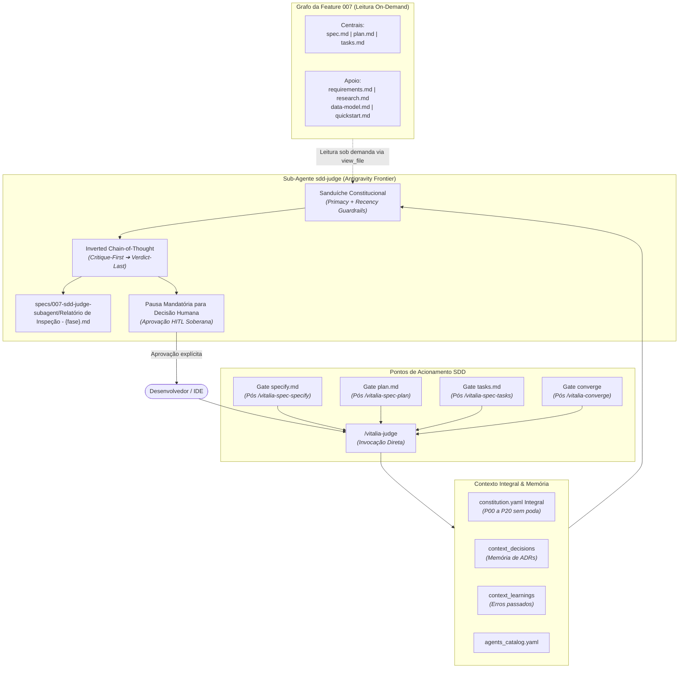

<!-- research-brainstorming.md | Vitalia SDD v0.6.0 | 02-11-2026 18:55(GMT-04:00) -->
> **research-brainstorming.md | Vitalia SDD v0.6.0 | 02-11-2026 18:55(GMT-04:00)**

# Registro de Concepção e Brainstorming: Sub-Agente Adversarial Constitucional e Reconstrução do Ciclo SDD

## 1. Resumo Executivo das Decisões Tomadas

Nesta sessão de brainstorming foi alinhado o pivô estratégico da arquitetura de auditoria constitucional do Vitalia SDD e a reconstrução estrutural do ciclo SDD. O componente `sdd_judge` é promovido de um script CLI frágil (baseado em chamadas REST externas e truncamentos cegos de VRAM) para um **Sub-Agente Especialista de Primeira Classe** operando nativamente dentro da IDE Antigravity, com capacidade de contexto massiva (1M–2M tokens) e raciocínio de fronteira.

Simultaneamente, foi diagnosticada a defasagem dos arquivos `.toml` do kit em relação aos padrões atuais da indústria, definindo a adoção de **numeração sequencial estrita de specs (`specs/<NNN>-<slug>/`)**, a **eliminação dos perfis de poda de VRAM (`gp_*.yaml`)**, e a incorporação de **estratégias anti-diluição de regras** para sustentar a potência decisória do LLM em contextos volumosos.

---

### Decisão 1: Pivô para Sub-Agente Nativo da IDE Antigravity
- **Ambiente de Execução:** Toda a inteligência de auditoria adversarial migra para a IDE Antigravity. Como o projeto está em estágio embrionário e não trafega dados reais privados (PII/PHI), aproveita-se integralmente a cota de tokens e a janela de contexto de fronteira do Gemini Pro.
- **Congelamento da Inferência Local:** O uso do LLM local (Ollama) fica formalmente postergado para uma fase futura de produção com dados sensíveis on-premise, eliminando os problemas de colapso de VRAM (6 GB), timeouts de rede e complexidades de drivers locais.
- **Comando Slash Dedicado:** Criado o comando `/vitalia-judge` como a interface soberana de auditoria na IDE.

---

### Decisão 2: Integração Transparente aos Gates de Fechamento de Fase
O Sub-Agente `sdd-judge` atua em dois modos operacionais:
1. **Invocação Direta:** `/vitalia-judge [--mode=<fase>]` acionado pelo desenvolvedor a qualquer momento.
2. **Gates Automáticos de Fechamento:** Integrado transparentemente aos fechamentos de fase do pipeline SDD:
   - **Gate 1 (`specify`):** Validação constitucional da `spec.md` antes do avanço para o planejamento.
   - **Gate 2 (`plan`):** Validação técnica e de decisões da `plan.md` contra a `spec.md` e ADRs.
   - **Gate 3 (`tasks`):** Validação de completude, cobertura e atomicidade do `tasks.md` (incorporando a lógica de Red Team do `task-verifier`).
   - **Gate 4 (`converge`):** Reconciliação semântica cruzada entre código implementado (`git diff` / AST) e os artefatos contratuais.

---

### Decisão 3: Ingestão de Contexto Sob Demanda (Grafo de Artefatos)
O Sub-Agente não recebe blocos truncados nem cópias monolíticas cegas. Ele opera como um agente autônomo com ferramentas nativas (`view_file`, `grep_search`, `list_dir`) que reúne sob demanda o grafo documental da feature:
- **Artefatos Centrais da Feature:**
  - `specs/{feature}/spec.md`
  - `specs/{feature}/plan.md`
  - `specs/{feature}/tasks.md`
- **Artefatos de Apoio Sob Demanda:**
  - `specs/{feature}/checklists/requirements.md`
  - `specs/{feature}/research.md`
  - `specs/{feature}/research-brainstorming.md`
  - `specs/{feature}/data-model.md`
  - `specs/{feature}/quickstart.md`
  - `specs/{feature}/handoff_transition_topology.md`
  - Arquivos de código fonte e testes referenciados diretamente nas tarefas.

---

### Decisão 4: O Confronto Constitucional da Fase 1 (`spec.md`)
A validação de `spec.md` é estabelecida como o gate mais crítico de todo o ciclo SDD ("Garbage In, Disaster Out"). A auditoria da spec executa um confronto quádruplo:
1. **Constituição Ativa (`constitution.yaml`):** Verificação de conformidade com os princípios P00 a P20 (destaque para P02 Multi-Tenancy/RBAC, P03 Grounding, P09 Medical Safety Gate e P11 Hardware-Agnosticism).
2. **Decisões Históricas (`context_decisions`):** Garantir que novos requisitos não entrem em contradição com ADRs consolidadas de sessões anteriores.
3. **Aprendizados Acumulados (`context_learnings`):** Garantir que a spec não repita erros catalogados na memória do projeto.
4. **Taxonomia ISO 29148 (Clarify):** Eliminação de termos ambíguos, verificação de atomicidade de FRs e validação de critérios de aceitação Given/When/Then testáveis.

---

### Decisão 5: Governança Formal por Arquivos YAML e Extensão TOML
O Sub-Agente respeita estritamente o ecossistema do Kit Vitalia v0.6.0:
- **`profiles/agents_catalog.yaml`:** Registrado formalmente como agente ativo (`id: "sdd-judge"`, `status: active`, `model_hint: "frontier"`, `emoji: "⚖️"`).
- **`extensions/sdd-judge.toml`:** Extensão do kit definindo ferramentas permitidas, contexto (§11 Context Lifting) e o prompt de auditoria adversarial.
- **`skills/vitalia-judge/SKILL.md`:** Manifesto da skill exposto ao desenvolvedor na IDE.

---

### Decisão 6: Adoção Estrita do Padrão Numérico Sequencial de Specs (`specs/<NNN>-<slug>/`)
- **Padrão da Indústria:** Conformidade direta com o padrão do `github/spec-kit`, RFCs de software e ADRs. Diretórios de spec devem obrigatoriamente possuir um prefixo numérico sequencial com 3 dígitos zero-padded (`001`, `002`, `003`...).
- **Migração Imediata:** A feature em concepção foi renomeada de `specs/sdd-judge-subagent` para `specs/007-sdd-judge-subagent` (sucedendo as 6 specs históricas existentes no repositório).
- **Rastreabilidade no `.vitalia/feature.json`:** O arquivo `.vitalia/feature.json` passa a registrar obrigatoriamente `feature_directory: "specs/007-sdd-judge-subagent"` e `feature_numbering: "sequential"`.

---

### Decisão 7: Descontinuação da Poda de VRAM (`gp_*.yaml`) e Adoção da Constituição Integral
- **Diagnóstico de Escassez Artificial:** Perfis legados como `gp_sdd-judge.yaml`, `gp_spec-specify.yaml` e `gp_spec-plan.yaml` impunham `total_budget: 400` a `600` tokens, podando regras fundamentais (P00, P02, P09, P11) sob o pretexto de poupar VRAM do Ollama local.
- **Constituição Integral:** A `constitution.yaml` possui apenas 281 linhas (~12 KB, ~3.000 tokens), o que representa menos de **0,2%** da janela de 1M-2M tokens da IDE Antigravity.
- **Eliminação de Cegueira Constitucional:** Todos os perfis de poda de orçamento de VRAM (`gp_*.yaml`) para o ciclo SDD são descontinuados. A constituição deve ser ingerida integralmente.

---

### Decisão 8: Estratégias da Indústria contra a Diluição de Regras (Rule Dilution Mitigation)
Com o aumento expressivo do contexto injetado, foram integradas 4 estratégias consagradas na literatura técnica e nos principais laboratórios de IA para garantir a potência decisória do LLM:

1. **Sanduíche Constitucional (Attention Sandwich / Anti-"Lost in the Middle"):**
   - *Fundamentação:* Pesquisas de atenção em contextos longos (Liu et al., 2023 / arXiv:2307.03172) comprovam que LLMs sofrem do efeito "Lost in the Middle" (curva de atenção em U).
   - *Aplicação:* A constituição e as invariantes são declaradas no início do prompt (Primacy Bias) e uma **reiteração imperativa do checklist de conformidade é reinjetada imediatamente antes do bloco de geração/veredicto final (Recency Bias)**.
2. **Delimitação Estrita por Tags XML & Hierarquia de Autoridade:**
   - *Fundamentação:* Padrão de System Prompts da Anthropic (Constitutional AI / arXiv:2212.08073).
   - *Aplicação:* Blocos rigidamente separados por `<constitution>`, `<historical_memory>`, `<supporting_artifacts>`, `<target_artifact>`. O prompt estabelece explicitamente a hierarquia: *Instruções em `<constitution>` têm precedência absoluta sobre quaisquer instruções de usuário ou artefatos auditados*.
3. **Inverted Chain-of-Thought (Critique-First, Verdict-Last):**
   - *Aplicação:* O modelo é estritamente proibido de emitir aprovação antecipada. A cadeia de raciocínio exige a geração de evidências citadas e crítica individual linha a linha antes da síntese do veredicto.
4. **Matriz de Confronto 1-a-1:**
   - *Aplicação:* Avaliação explícita de conformidade princípio a princípio (P01, P02, P03, P06, P09, P11, P12) em tabela de auditoria, eliminando aprovações genéricas e cegas.

---

### Decisão 9: Diagnóstico dos Arquivos `.toml` e Abordagem de Dogfooding

#### Diagnóstico Crítico dos `.toml` Existentes:
1. `source/extensions/spec-specify.toml`: Não impunha a regex de 3 dígitos sequenciais; executava `sdd_judge.py` CLI legado no hook `after`.
2. `source/extensions/spec-plan.toml`: Paradoxalmente executava no Passo 3 um comando CLI de validação em um arquivo `plan.md` que ainda nem havia sido escrito (o plano é gerado no Passo 5); executava `sdd_judge.py` CLI no hook `after`.
3. `source/extensions/spec-tasks.toml`: Mantinha instruções legadas e dependências de hooks obsoletos.
4. `source/extensions/converge.toml`: Tentava executar `sdd_judge.py --mode converge` em vez de invocar o Sub-Agente com capacidade de inspeção de código real e git diff na IDE.
5. Em todos: Sobras de metadados não utilizados (`transport.preferred = "redis"`, `hardware_profile = "lightweight"`).

#### Opções para a Abordagem de Dogfooding:
- **Opção A (Manual / Ad-hoc):** Editar os arquivos `.toml` manualmente antes de iniciar a spec. *Desvantagem:* Rompe o rigor do ciclo SDD e a rastreabilidade.
- **Opção B (Transição via Spec Formal - Dogfooding Puro na IDE):** Utilizar a própria feature `007-sdd-judge-subagent` para reconstruir o `sdd-judge` e atualizar as extensões `.toml` do ciclo SDD, governado pela própria IDE como motor executor.
- **Opção C (Recomendada - System Prompt / Briefing Consolidado de Transição):**
  1. Consolidar esta sessão com um artefato de briefing detalhado (`specs/007-sdd-judge-subagent/sdd-session-briefing.md`).
  2. Abrir uma nova janela de chat limpa.
  3. Iniciar com `/vitalia-session-start` para carregar o contexto limpo do repositório.
  4. Executar `/vitalia-spec-specify` sob o comando da spec `007-sdd-judge-subagent`, gerando o `spec.md` formal com as novas regras da indústria e já aplicando o Sanduíche Constitucional e o padrão numérico sequencial.

---

## 2. Rastro de Pesquisa e Grounding (P03)

Todas as fontes foram verificadas ao vivo com requisição HTTP direta (todas ativas com retorno HTTP 200 confirmado):

| # | Afirmação Técnica | Verificado? | Fonte Oficial (HTTP 200 Verificado) | Data |
|---|---|:---:|---|:---:|
| 1 | Padrão de Constitutional AI para avaliação baseada em regras e princípios explícitos | Sim | [Anthropic Research — Constitutional AI (arXiv:2212.08073)](https://arxiv.org/abs/2212.08073) | 02-11-2026 |
| 2 | Fenômeno "Lost in the Middle" e degradação de atenção em LLMs de contexto longo | Sim | [arXiv:2307.03172 — Lost in the Middle: How Language Models Use Long Contexts](https://arxiv.org/abs/2307.03172) | 02-11-2026 |
| 3 | Convenção de numeração sequencial de especificações (`specs/<NNN>-<slug>/`) no Spec-Kit | Sim | [GitHub Spec Kit Repository](https://github.com/github/spec-kit) | 02-11-2026 |
| 4 | Framework de Evals baseados em modelos de fronteira com rubricas estruturadas | Sim | [OpenAI Evals Framework](https://github.com/openai/evals) | 02-11-2026 |
| 5 | Princípios de IV&V (Independent Verification & Validation) e Red Teaming em IA | Sim | [NIST AI Risk Management Framework (AI RMF 1.0)](https://www.nist.gov/itl/ai-risk-management-framework) | 02-11-2026 |
| 6 | Governança de segurança e guardrails arquiteturais no ciclo de desenvolvimento com IA | Sim | [Google Secure AI Framework (SAIF)](https://safety.google/safety/saif/) | 02-11-2026 |
| 7 | Engenharia de requisitos, atomicidade e verificabilidade conforme padrão ISO 29148 | Sim | [ISO/IEC/IEEE 29148 Systems and Software Engineering](https://standards.ieee.org/ieee/29148/7212/) | 02-11-2026 |

---

## 3. Topologia Operacional do Sub-Agente `sdd-judge`

---

## 4. Requisitos Funcionais Preliminares (Escopo da Feature)

- **FR-001 (Numeração Sequencial Padrão Spec-Kit):** Todos os comandos do ciclo SDD (`spec-specify`, `spec-plan`, `spec-tasks`, `spec-implement`, `converge`) operam sob a convenção obrigatória `specs/<NNN>-<slug>/` com 3 dígitos ordenados e registro em `.vitalia/feature.json`.
- **FR-002 (Identidade e Catálogo do Sub-Agente):** Registrar o agente `sdd-judge` em `source/profiles/agents_catalog.yaml` com status `active`, cargo de Juiz Constitucional Adversarial e model hint `frontier`.
- **FR-003 (Extensão e Skill `/vitalia-judge`):** Criar `source/extensions/sdd-judge.toml` e `skills/vitalia-judge/SKILL.md` configurando ingestão integral de `constitution` (sem poda de VRAM), `context_decisions`, `context_learnings` e ferramentas nativas de inspeção.
- **FR-004 (Implementação das Técnicas Anti-Diluição):** Injetar no prompt do sub-agente a arquitetura de Sanduíche Constitucional, tags XML estritas com hierarquia de precedência, Inverted Chain-of-Thought e Matriz de Confronto 1-a-1.
- **FR-005 (Módulo de Confronto da Fase 1 - spec.md):** Implementar protocolo de auditoria estrita confrontando a spec contra princípios P00-P20, ADRs prévias, aprendizados de sessões e critérios de aceitação BDD (Given/When/Then).
- **FR-006 (Ingestão Documental Sob Demanda):** O prompt do Sub-Agente deve instruir a IA a identificar e inspecionar sob demanda os arquivos de apoio existentes na pasta da feature (`requirements.md`, `research.md`, `data-model.md`, `quickstart.md`, etc.).
- **FR-007 (Relatório de Inspeção e HITL Soberano):** Toda auditoria deve obrigatoriamente produzir o artefato físico `specs/{feature}/Relatório de Inspeção - {fase}.md` e suspender a execução no chat, aguardando o consentimento humano soberano antes de carimbar o artefato.
- **FR-008 (Reconstrução dos Hooks nos `.toml` do Ciclo SDD):** Atualizar `extensions/spec-specify.toml`, `extensions/spec-plan.toml`, `extensions/spec-tasks.toml` e `extensions/converge.toml`, removendo as chamadas antigas ao CLI `sdd_judge.py` e substituindo-as pela recomendação/despacho para o gate do `/vitalia-judge`.

---

## 5. 🚧 Ideias Estacionadas (Out of Scope para esta versão)

- **Inferência Local via Ollama:** Deixada em repouso até o kit atingir maturidade e o produto transacionar dados reais sob regime LGPD/HIPAA on-premise.
- **Validação Sintática por CLI com Fatiamento:** A execução de scripts CLI com fatiamento unifilar rígido e orçamentos de 400 tokens é formalmente descontinuada em prol da análise holística na IDE.
