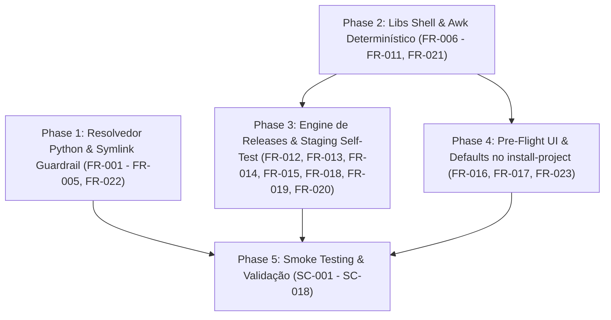

<!-- plan.md | Vitalia SDD v0.6.0 | 02-11-2026 09:18(GMT-04:00) -->
> **plan.md | Vitalia SDD v0.6.0 | 02-11-2026 09:18(GMT-04:00)**

# Implementation Plan: Kit Install Hardening

**Branch**: `kit-install-hardening` | **Date**: 02-11-2026 | **Spec**: [spec.md](file:///home/andre/projetos/assistidos/kit_src/specs/kit-install-hardening/spec.md)

## Summary

Corrigir o vazamento de handoffs para `~/.vitalia/memory/`, implementar governança de `.env` não-destrutiva (matriz S1–S7), modularizar `kit-bootstrap.sh` e `install-project` em bibliotecas shell com SRP, e preservar `AGENTS.md` e skills com marcadores delimitados e manifesto SHA-256. Implementar a arquitetura de releases atômicas no padrão Capistrano (`~/.vitalia-releases/<ts>/` com symlink ativo `~/.vitalia` promovido via `mv -T`), preservando o estado compartilhado de Context Lifting em `~/.vitalia-shared/tmp/`, executando self-test pré-ativação em staging, blindando a resolução de manifesto com `awk` sob `pipefail`, resolvendo symlinks canônicos com `.resolve()` no guardrail Python e fornecendo banner interativo de pré-voo no `install-project`.

## Technical Context

**Language/Version**: Python 3.10+ (resolvedor e guardrails), Bash 3.2+ (libs shell)
**Primary Dependencies**: Python stdlib (`pathlib`, `hashlib`, `json`, `os`), GNU coreutils (`mv -T`, `sha256sum`), POSIX utilities (`awk`, `rsync`, `git`)
**Storage**: Filesystem local (`.vitalia/memory/data_storage/handoffs/`), `~/.vitalia-shared/tmp/` (stubs), `~/.vitalia-releases/` (versões históricas); sem banco
**Testing**: pytest (Python), testes unitários de regressão, smoke tests shell e idempotência
**Target Platform**: Linux (GNU coreutils `mv -T`, POSIX shell, python 3.10+)
**Project Type**: CLI / infraestrutura de instalação e runtime
**Performance Goals**: Swap de release em < 100ms; zero downtime; zero perda de stubs
**Constraints**: Bash 3.2 (sem arrays associativos), `set -euo pipefail`, stdlib-only no resolvedor Python, colocalização no mesmo filesystem (`$HOME`)

## Constitution Check

✅ **PASS (spec)** — SDDJudge: `spec.md` aprovada com 23 Requisitos Funcionais e 18 Cenários de Aceite.
✅ **Pipeline P01**: specify (✅ PASS) → plan (este artefato) → tasks (pendente) → implement (pendente).

Princípios verificados:
- **P01 (SDD Pipeline)**: Pipeline inviolável seguido: spec.md aprovada antes do plan.
- **P03 (Grounding)**: Todas as 11 decisões técnicas possuem campo "Verificado em" com fontes oficiais e data — ver [research.md](file:///home/andre/projetos/assistidos/kit_src/specs/kit-install-hardening/research.md).
- **P04 (Timestamp)**: Todos os artefatos seguem o cabeçalho `<!-- arquivo | Vitalia SDD v0.6.0 | DD-MM-YYYY HH:MM(GMT-04:00) -->`.
- **P06 (Secrets)**: `.env` nunca comitado; backup local apenas.
- **P07 (Zero Data Leak)**: Resolução de storage com `.resolve()` garante que handoffs nunca caiam em `~/.vitalia` nem em symlinks externos.
- **P11 (Hardware Agnostic)**: Nenhum modelo LLM hardcoded neste plano.
- **P15 (Observability)**: `logger.sh` implementa logging estruturado com níveis e diagnóstico claro de transição de versão.

## Technical Decisions

> Projeto com 5+ arquivos afetados e interface CLI — decisões embutidas neste plan.md.
> Detalhes de pesquisa e alternativas com fontes verificadas (P03 Grounding) em [research.md](file:///home/andre/projetos/assistidos/kit_src/specs/kit-install-hardening/research.md).
> Cada decisão possui campo "Verificado em" com URL/evidência e data de verificação.

### ADR-01: Resolvedor autocontido vs. reutilizar `find_project_root()`
- **Escolhido**: Resolvedor dedicado `resolve_project_root()` autocontido em `vitalia_handoff.py`.
- **Verificado em**: Teste local executado com `.venv/bin/python` em 31-10-2026.
- **Justificativa**: `find_project_root()` de `kit_env_bootstrap.py` retorna `$HOME` a partir de `~/projetos` (verificado por teste 31-10-2026); o `.git` aninhado em `data_storage/` faz `find_project_root()` retornar `data_storage` como raiz. Alterar a função existente quebraria `gemini.py` e `scan_environment`.
- **Alternativas rejeitadas**: Refatorar `find_project_root()` (quebraria dependentes), usar env var `PROJECT_ROOT` (injetável incorretamente pelo LLM).

### ADR-02: Marcadores delimitados para `AGENTS.md`
- **Escolhido**: `<!-- VITALIA:KIT:START -->` / `<!-- VITALIA:KIT:END -->` com detecção de legado.
- **Verificado em**: Teste em IDE Antigravity em 31-10-2026.
- **Justificativa**: Marcadores HTML são invisíveis no Markdown renderizado e permitem substituição cirúrgica. Detecção de legado via `grep -q "# AGENTS.md — Kit Global"` evita duplicação (B4).
- **Alternativas rejeitadas**: Arquivo separado `.agents/VITALIA.md` (IDEs só leem `AGENTS.md`), append simples (duplicação a cada reinstalação).

### ADR-03: Manifesto SHA-256 vs. diff direto
- **Escolhido**: `.agents/skills/.vitalia-manifest` com hash SHA-256 por skill.
- **Verificado em**: Disponibilidade de `sha256sum` em coreutils GNU em 31-10-2026.
- **Justificativa**: O template de SKILL.md contém `{{VERSION}}`; a cada versão o hash muda mesmo sem edição do usuário. O manifesto permite distinguir "atualização de versão" (hash = manifesto) de "edição do usuário" (hash ≠ manifesto). Diff direto não distingue esses dois cenários.
- **Alternativas rejeitadas**: Diff textual (falsos positivos por mudança de versão), timestamp de modificação (não confiável após `git clone`).

### ADR-04: Localização das libs shell
- **Escolhido**: `source/bin/lib/` (repositório) → replicadas em `~/.vitalia/bin/lib/` pelo rsync.
- **Verificado em**: Estrutura modular do repositório em 31-10-2026.
- **Justificativa**: O rsync copia `source/` inteiro para `~/.vitalia/`; adicionar `bin/lib/` segue o padrão existente. `install-project` localiza via `BASH_SOURCE` relativo.
- **Alternativas rejeitadas**: Embedded functions no próprio script (viola SRP), pasta separada `/opt/vitalia/` (requer sudo).

### ADR-05: Regex de detecção de variáveis no `.env`
- **Escolhido**: `^[[:space:]]*(export[[:space:]]+)?VAR[[:space:]]*=` com `grep -q`.
- **Verificado em**: Testado com GNU grep 3.11 e BSD grep em 31-10-2026.
- **Justificativa**: Cobre: `VAR=value`, `export VAR=value`, `  VAR = value`, `export  VAR="value"`. Regex POSIX, compatível com bash 3.2 e grep GNU/BSD.
- **Alternativas rejeitadas**: Parse do `.env` com Python (introduz dependência no shell script), `source .env && test -v VAR` (executa o `.env`, risco de side-effects).

### ADR-06: Promoção Atômica por Symlink via `mv -T` e Auditoria de Releases (FR-018)
- **Escolhido**: Estrutura `~/.vitalia-releases/<timestamp>/` com swap atômico via `ln -sfn ... ~/.vitalia.tmp && mv -T ~/.vitalia.tmp ~/.vitalia` no mesmo filesystem (`$HOME`).
- **Verificado em**: [Linux rename(2) man page](https://man7.org/linux/man-pages/man2/rename.2.html), [Capistrano Deployment Flow](https://capistranorb.com/documentation/getting-started/flow/), [BashFAQ/105](https://mywiki.wooledge.org/BashFAQ/105) em 02-11-2026.
- **Justificativa**: A syscall `rename(2)` do kernel Linux retorna `ENOTEMPTY` se o alvo for um diretório não-vazio. A promoção de um symlink via `mv -T` é atômica no inode e elimina qualquer janela de inconsistência ou downtime. Garante histórico auditável em `~/.vitalia-releases/`.
- **Alternativas rejeitadas**: `rsync --delete` in-place (inconsistência durante a cópia), `mv dir_novo dir_antigo` (falha com `ENOTEMPTY`).

### ADR-07: Persistência de Context Lifting via Symlink para `~/.vitalia-shared/tmp/` (FR-019)
- **Escolhido**: Diretório persistente `~/.vitalia-shared/tmp/`, linkado em cada release via `~/.vitalia-releases/<timestamp>/tmp -> ~/.vitalia-shared/tmp`.
- **Verificado em**: [The Twelve-Factor App: Processes (Stateless releases)](https://12factor.net/processes), [XDG Base Directory Specification](https://specifications.freedesktop.org/basedir-spec/basedir-spec-latest.html) em 02-11-2026.
- **Justificativa**: Os stubs JSON de Context Lifting gerados pelo `vitalia_hook_runner.py` representam estado de sessão ativo. As releases do kit devem ser imutáveis e auditáveis, mas os stubs de sessão ativa devem persistir e sobreviver a todos os upgrades sem perda de contexto.
- **Alternativas rejeitadas**: Copiar `tmp/` a cada upgrade (lento e duplica I/O), usar `/tmp/` do SO (violação P07 e sujeito a limpeza automática).

### ADR-08: Staging Isolado com Bateria de Auto-Teste Pré-Promoção (FR-020)
- **Escolhido**: Preparar a nova release em `~/.vitalia-releases/<ts>.staging/` e rodar auto-testes (`bash -n`, sourcing sob `set -euo pipefail`, testes de compilação Python e teste de manifesto) antes do rename atômico.
- **Verificado em**: [Martin Fowler: Blue-Green Deployment](https://martinfowler.com/bliki/BlueGreenDeployment.html) em 02-11-2026.
- **Justificativa**: Garante fail-fast: qualquer erro de sintaxe ou quebra de pipefail aborta a instalação no staging, mantendo a release atual ativa e inalterada.
- **Alternativas rejeitadas**: Teste pós-promoção com rollback (instabilidade temporária), sem auto-teste (risco de quebra sistêmica).

### ADR-09: Resolução Determinística de Manifesto com `awk` em `agent_preserver.sh` (FR-021)
- **Escolhido**: `awk -v p="$rel_path" '$2 == p { print $1; exit }' "$manifest_file" || true`.
- **Verificado em**: [GNU Awk User's Guide (POSIX awk standard)](https://www.gnu.org/software/gawk/manual/gawk.html) em 02-11-2026.
- **Justificativa**: Sob `set -o pipefail`, o pipeline `grep -E ... | awk ...` retorna exit code 1 quando `grep` não encontra a chave (como ocorre na primeira instalação de novas skills), abortando imediatamente o script sob `set -e`. O `awk` lê o arquivo diretamente, encerra no primeiro match e não falha quando a chave não existe.
- **Alternativas rejeitadas**: `grep ... || true | awk ...` (mascara erros de I/O), loop `while read` em bash puro (sobrecarga de performance).

### ADR-10: Blindagem de Resolução de Symlinks no Guardrail Python (`.resolve()`) (FR-022)
- **Escolhido**: `kit_dir = Path(kit_dir_env).resolve() if kit_dir_env else (home / ".vitalia").resolve()`.
- **Verificado em**: [Python pathlib.Path.resolve() documentation (PEP 428)](https://docs.python.org/3/library/pathlib.html#pathlib.Path.resolve) em 02-11-2026.
- **Justificativa**: Quando `~/.vitalia` é um symlink para `~/.vitalia-releases/<ts>`, `resolved_storage.relative_to(kit_dir)` falharia com `ValueError` se `kit_dir` não fosse explicitamente resolvido. Resolver ambos os caminhos garante a comparação canônica no filesystem.
- **Alternativas rejeitadas**: Comparação textual simples de prefixos de string (não resolve symlinks ou caminhos relativos).

### ADR-11: Banner de Pré-Voo e Sugestão de Defaults no `install-project` (FR-023)
- **Escolhido**: Identificação automática do modo (`NOVA_INSTALACAO` vs `UPGRADE`), exibindo transição de versão no banner e sugerindo URLs de memória já registradas em `.vitalia/config.yml`.
- **Verificado em**: Padrão de UX CLI (Heroku CLI / npm / yarn pre-flight banners) em 02-11-2026.
- **Justificativa**: Evita que o usuário precise redigitar URLs remotas de memória durante upgrades e deixa transparente a transição de versão do kit no projeto.
- **Alternativas rejeitadas**: Solicitar confirmação cega sem mostrar URLs anteriores, sobrescrever configurações sem perguntar.

---

## Project Structure

### Documentation (this feature)

```
specs/kit-install-hardening/
├── spec.md                          ← especificação (aprovada)
├── plan.md                          ← este arquivo
├── research.md                      ← decisões técnicas com alternativas
├── checklists/
│   └── requirements.md              ← checklist de qualidade
└── contracts/
    └── cli-contract.md              ← contrato do CLI --project-root
```

### Source Code (arquivos afetados e novos)

```
source/
├── bin/
│   ├── install-project              ← MODIFICADO: refatorar para consumir libs, banner pré-voo (FR-016, FR-017, FR-023)
│   └── lib/                         ← NOVO: bibliotecas shell
│       ├── logger.sh                ← FR-006
│       ├── env_manager.sh           ← FR-007
│       ├── agent_preserver.sh       ← FR-008, FR-009, FR-021 (awk determinístico)
│       ├── redis_detector.sh        ← FR-010
│       └── git_storage_manager.sh   ← FR-011
├── src/
│   ├── vitalia_handoff.py           ← MODIFICADO: FR-001 a FR-005, FR-022 (.resolve() em kit_dir)
│   ├── vitalia_hook_runner.py       ← MODIFICADO: FR-005 (L216)
│   └── hooks/
│       └── guardian_context.py      ← MODIFICADO: FR-005 (L329)
kit-bootstrap.sh                     ← MODIFICADO: FR-012 a FR-015, FR-018 (releases/mv -T), FR-019 (shared tmp), FR-020 (self-test)

~/.vitalia-releases/<timestamp>/     ← NOVO: Releases imutáveis com auditoria histórica
~/.vitalia-shared/tmp/               ← NOVO: Estado persistente de Context Lifting
~/.vitalia                           ← Symlink ativo apontando para ~/.vitalia-releases/<ts>

tests/
├── unit/
│   └── test_vitalia_handoff.py      ← MODIFICADO: novos testes de regressão e symlinks
└── smoke_install_project.sh         ← NOVO: teste ponta a ponta de upgrade legado e idempotência
```

---

## Phase Overview

### Phase 1: Foundation — Resolvedor Python e Guardrails de Symlink (FR-001 a FR-005, FR-022)

**Escopo:** Implementar o resolvedor de raiz de projeto dedicado e os guardrails de Zero Data Leak blindados contra symlinks.

**Arquivos:**
- `source/src/vitalia_handoff.py` — Adicionar `resolve_project_root(start=None)` e `resolve_storage_dir(start=None, lenient=False)`. Refatorar `get_default_storage_dir()` para usar o resolvedor. Adicionar `--project-root` ao argparse. Aplicar `.resolve()` em `kit_dir` (FR-022).
- `source/src/vitalia_hook_runner.py` — Atualizar resolvedor lenient (L216).
- `source/src/hooks/guardian_context.py` — Atualizar resolvedor lenient (L329).
- `tests/unit/test_vitalia_handoff.py` — Novos testes: cwd em subpasta sem marcadores, cwd dentro de `data_storage/`, cwd dentro de `~/.vitalia/`, projeto sem `data_storage`, guardrail de `$HOME`, `--project-root` explícito, e teste com `~/.vitalia` como symlink para releases.

**Blindagem de Resolução de Symlinks (FR-022):**
```python
kit_dir_env = os.environ.get("VITALIA_KIT_DIR")
kit_dir = Path(kit_dir_env).resolve() if kit_dir_env else (Path.home() / ".vitalia").resolve()

# Guardrail: storage resolvido não pode residir dentro de kit_dir resolvido
try:
    resolved_storage.relative_to(kit_dir)
    raise RuntimeError(
        f"CRITICAL: Storage resolvido '{resolved_storage}' reside dentro de '{kit_dir}' (Zero Data Leak violation)."
    )
except ValueError:
    pass  # Caminho seguro fora do kit global
```

---

### Phase 2: Foundation — Bibliotecas Shell e Awk Determinístico (FR-006 a FR-011, FR-021)

**Escopo:** Criar as 5 bibliotecas shell em `source/bin/lib/` e garantir parsing determinístico sob `set -euo pipefail`.

#### 2.1 `logger.sh` (FR-006)
Logging estruturado com níveis, prefixo de etapa e supressão de cores caso stdout não seja terminal.

#### 2.2 `env_manager.sh` (FR-007)
Gestão não-destrutiva de `.env` aplicando a matriz S1–S7 completa.

#### 2.3 `agent_preserver.sh` (FR-008, FR-009, FR-021)
- `update_agents_md`: preservação de `AGENTS.md` com marcadores e migração de legado.
- `update_skill` e `get_manifest_hash`: **Resolução Determinística de Manifesto com Awk (FR-021)**:
  ```bash
  get_manifest_hash() {
      local manifest_file="$1"
      local rel_path="$2"
      [ -f "$manifest_file" ] || return 0
      awk -v p="$rel_path" '$2 == p { print $1; exit }' "$manifest_file" 2>/dev/null || true
  }
  ```
  Elimina o pipeline `grep | awk` suscetível ao `pipefail` quando a skill não existe no manifesto.

#### 2.4 `redis_detector.sh` (FR-010)
Probe de Redis com fallback de arquivo e valor padrão `redis://localhost:6379/0`.

#### 2.5 `git_storage_manager.sh` (FR-011)
Gerenciamento de repositórios Git de sessão e data_storage.

---

### Phase 3: Engine de Releases Atômicas e Staging no `kit-bootstrap.sh` (FR-012 a FR-015, FR-018, FR-019, FR-020)

**Escopo:** Implementar o fluxo de staging com self-test, swap atômico via symlink (`mv -T`), pasta compartilhada `tmp/` e expurgo de memória órfã.

**Algoritmo do Bootstrap:**

```bash
# 1. Pré-requisitos Fail-Fast (FR-014)
# Validação de root, python3 >= 3.10, python3-venv, git, rsync.

# 2. Definição de Estrutura de Diretórios (FR-018, FR-019)
TIMESTAMP="$(date +%Y%m%d_%H%M%S)"
RELEASES_BASE="${HOME}/.vitalia-releases"
SHARED_BASE="${HOME}/.vitalia-shared"
STAGING_DIR="${RELEASES_BASE}/${TIMESTAMP}.staging"
FINAL_RELEASE_DIR="${RELEASES_BASE}/${TIMESTAMP}"
TARGET_SYMLINK="${HOME}/.vitalia"

mkdir -p "${RELEASES_BASE}" "${SHARED_BASE}/tmp"

# 3. Cópia Rsync para Staging Isolado (FR-012)
rsync --archive --checksum \
    --exclude="*.pyc" --exclude="__pycache__" --exclude=".git" \
    --exclude="/tmp/" --filter="protect /tmp/***" \
    "${KIT_SRC_DIR}/" "${STAGING_DIR}/"

# 4. Acoplamento de Estado Compartilhado (FR-019)
ln -sfn "${SHARED_BASE}/tmp" "${STAGING_DIR}/tmp"

# 5. Bateria de Auto-Teste em Staging (Self-Test) (FR-020)
# - bash -n em todos os arquivos .sh
# - sourcing das libs sob set -euo pipefail em subshell
# - verificação sintática e de importação em Python
# - teste de extração de manifesto via awk
if ! run_staging_self_tests "${STAGING_DIR}"; then
    log_error "Self-test falhou no staging. Abortando sem alterar a release ativa."
    rm -rf "${STAGING_DIR}"
    exit 1
fi

# 6. Efetivação do Diretório de Release
mv "${STAGING_DIR}" "${FINAL_RELEASE_DIR}"

# 7. Migração de Legado (se ~/.vitalia for diretório físico) (FR-018)
if [ -d "${TARGET_SYMLINK}" ] && [ ! -L "${TARGET_SYMLINK}" ]; then
    LEGACY_BACKUP="${RELEASES_BASE}/legacy_${TIMESTAMP}"
    log_warn "Convertendo instalação legada física para release ${LEGACY_BACKUP}..."
    mv "${TARGET_SYMLINK}" "${LEGACY_BACKUP}"
fi

# 8. Swap Atômico no Kernel via mv -T (FR-018)
TEMP_LINK="${HOME}/.vitalia.tmp.${TIMESTAMP}"
ln -sfn "${FINAL_RELEASE_DIR}" "${TEMP_LINK}"
mv -T "${TEMP_LINK}" "${TARGET_SYMLINK}"

# 9. Expurgo Silencioso Automático de Legado (FR-013, NF-005 - Opção C)
rm -rf "${HOME}/.vitalia-releases"/*/memory "${SHARED_BASE}/memory" 2>/dev/null || true
```

---

### Phase 4: Modernização da Experiência no `install-project` (FR-016, FR-017, FR-023)

**Escopo:** Consumir bibliotecas shell, exibir banner de transição e sugerir URLs existentes.

1. **Carregamento de libs com Fail-Fast (FR-016):**
   Garante carregamento de `logger.sh`, `env_manager.sh`, `agent_preserver.sh`, `redis_detector.sh`, `git_storage_manager.sh`.
2. **Pré-Voo e Sugestão de Defaults (FR-023):**
   - Detecta versão atual do projeto (lendo `.agents/AGENTS.md` ou `.vitalia/version`).
   - Detecta se é `NOVA_INSTALACAO` ou `UPGRADE (v0.5.x -> v0.6.0)`.
   - Se `config.yml` contiver URLs de git de memória, sugere-as interativamente como padrão com timeout ou aceitação via Enter.
3. **`REDIS_URL` unificado (FR-017):**
   Garante `redis://localhost:6379/0` como padrão canônico.

---

### Phase 5: Polish, Smoke Testing & Idempotência

**Escopo:** Validação completa e testes automatizados.

1. **Novo Smoke Test `tests/smoke_install_project.sh`**:
   - Simula um projeto legado v0.5.x com múltiplas skills (`vitalia-route`, `vitalia-analyze`, etc.).
   - Executa `install-project` atualizando para v0.6.0 sob `set -euo pipefail`.
   - Assegura que o manifesto é populado sem quebras.
   - Executa segunda vez (idempotência) validando que nenhum arquivo é duplicado ou quebrado.
2. **Suíte pytest**:
   - Rodar `pytest tests/unit/test_vitalia_handoff.py`.
3. **Validação do SDDJudge em modo plan**:
   - Rodar `python3 ~/.vitalia/src/hooks/sdd_judge.py --mode plan specs/kit-install-hardening/plan.md`.

---

## Risk Mitigation

| Risco | Impacto | Mitigação |
|---|---|---|
| Quebra de pipefail ao ler manifesto | Alta | Substituição de pipeline por `awk` determinístico com fallback `|| true` (FR-021). |
| Falha durante atualização deixa kit quebrado | Crítica | Staging isolado com self-test prévio; swap atômico `mv -T` sem estado intermediário (FR-018, FR-020). |
| Perda de stubs de Context Lifting no upgrade | Alta | Persistência em `~/.vitalia-shared/tmp/` com symlinks preservados em cada release (FR-019). |
| Violação de Zero Data Leak em symlinks | Crítica | `.resolve()` explícito em `kit_dir` e `storage_dir` no guardrail de `vitalia_handoff.py` (FR-022). |
| Incompatibilidade com sistemas de arquivos remotos | Média | Verificação de que `$HOME` e staging residem no mesmo mount/filesystem antes do `mv -T` (NF-008). |

---

## Dependency Graph



- **Phase 1 e Phase 2** são independentes e podem ser desenvolvidas em paralelo.
- **Phase 3 e Phase 4** dependem das bibliotecas shell consolidadas na Phase 2.
- **Phase 5** consolida e valida ponta a ponta todas as fases implementadas.

