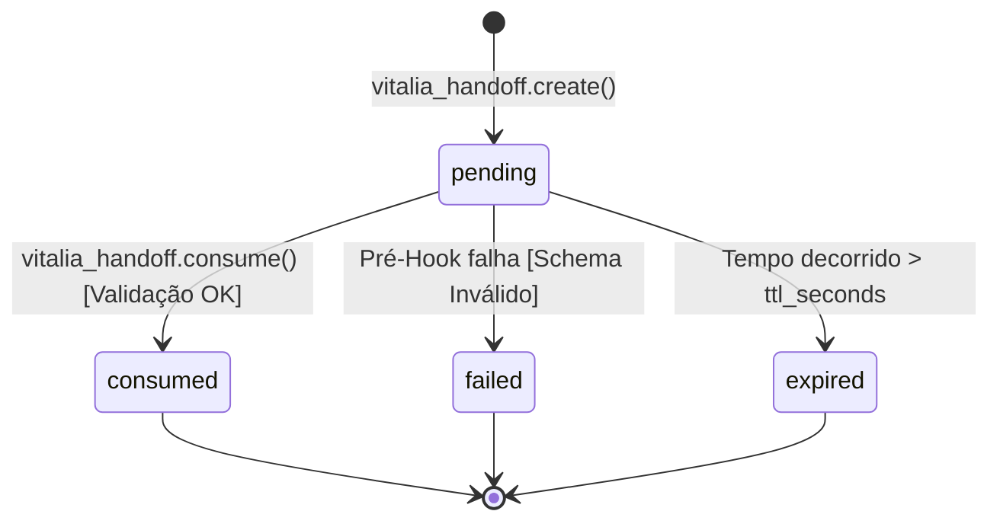

<!-- data-model.md | Vitalia SDD v0.6.0 | 17-10-2026 10:28(GMT-04:00) -->
# Data Model: kit-routing-subagents

Este documento define as entidades, ciclo de vida e estruturas de dados do **Ledger Local de Handoffs** e do **Catálogo Saneado de Agentes**, atendendo aos Princípios P01 (*SDD Inviolability*), P07 (*Privacy by Design*) e P12 (*Agent Security*).

---

## 1. Entidade: WorkflowHandoff (`handoff_<uuid>.json`)

Arquivo transacional persistido estritamente em `.vitalia/memory/data_storage/handoffs/`.

### Campos e Tipagem

| Campo | Tipo | Restrição / Formato | Descrição |
|---|---|---|---|
| `schema_type` | `string` | `"workflow_handoff"` | Identificador do schema formal |
| `schema_version` | `string` | Regex `^\d+\.\d+\.\d+$` (ex: `"1.0.0"`) | Versão semântica do contrato |
| `envelope.handoff_id` | `string` | UUID v4 canônico | Identificador único da transação de handoff |
| `envelope.source_workflow` | `string` | Identificador kebab-case | Workflow ou agente originador (ex: `"brainstorming"`, `"django-stark"`) |
| `envelope.target_workflow` | `string` | Identificador kebab-case | Destinatário pretendido ou `"vitalia-route"` para despacho |
| `envelope.timestamp` | `string` | ISO 8601 com fuso GMT-04:00 (`YYYY-MM-DDTHH:MM:SS-04:00`) | Carimbo temporal imutável |
| `envelope.machine_id` | `string` | SHA256[:8] do hostname | Identidade de hardware da máquina local (Princípio P11) |
| `envelope.ttl_seconds` | `integer` | Padrão: `3600` (1 hora) | Janela de validade da transação |
| `envelope.status` | `string` | Enum `["pending", "consumed", "expired", "failed"]` | Estado transacional no ledger |
| `intent.intent_type` | `string` | Enum `["brainstorming_to_route", "route_to_brainstorming", "route_dispatch"]` | Tipo de operação de trânsito |
| `intent.source_input` | `string` | Texto limpo | Entrada original textual fornecida pelo usuário |
| `intent.normalized_summary` | `string` | Texto ou caminho de arquivo | Síntese normalizada ou referência para `research-brainstorming.md` |
| `intent.detected_domain` | `string` | Identificador semântico | Domínio classificado via `brainstorming_intents.yaml` |
| `intent.confidence` | `number` | Float entre `0.0` e `1.0` | Nível de certeza da intenção |
| `intent.feature_context` | `string` | Caminho relativo | Diretório da feature ativa (ex: `"specs/kit-routing-subagents"`) |

---

## 2. Ciclo de Vida e Máquina de Estados do Handoff

### Transições Atômicas
- **Criação (`pending`):** Criado com permissões de leitura/escrita seguras pelo usuário do processo. O arquivo recebe o nome `handoff_<uuid>.json`.
- **Consumo (`consumed`):** O processo de destino valida o arquivo contra o schema JSON. Se aprovado, realiza a gravação do status atualizado em um arquivo temporário no mesmo diretório e executa a substituição atômica via `os.replace`, garantindo que leituras concorrentes nunca encontrem dados inconsistentes.
- **Expiração / Rejeição:** Se `ttl_seconds` expirar ou o schema for violado, o arquivo é marcado e a execução do workflow de destino é interrompida com código de erro 1.

---

## 3. Entidade: AgentDefinition (`agents_catalog.yaml`)

Definição estendida de entidades no catálogo de agentes com rastreamento de operacionalidade.

### Campos e Tipagem

| Campo | Tipo | Enum / Restrição | Descrição |
|---|---|---|---|
| `name` | `string` | Identificador kebab-case | Identificador único do agente (ex: `"django-stark"`) |
| `display_name` | `string` | Texto livre | Nome amigável para exibição na interface (ex: `"Django-Stark"`) |
| `role` | `string` | Texto descritivo | Papel e especialidade técnica da entidade |
| `status` | `string` | Enum `["active", "planned"]` | Estado operacional do agente no ecossistema |
| `emoji` | `string` | Caractere Unicode | Ícone visual associado ao agente |
| `model_hint` | `string` | Enum `["frontier", "heavy", "lightweight"]` | Perfil de capacidade de hardware recomendado |
| `queue` | `string` | String padrão `vitalia:agents:<name>` | Fila lógica mapeada no barramento de eventos |
| `inputs` | `array[string]` | Nomes de tipos | Contratos esperados de entrada |
| `outputs` | `array[string]` | Nomes de tipos | Contratos de saída gerados pelo especialista |
