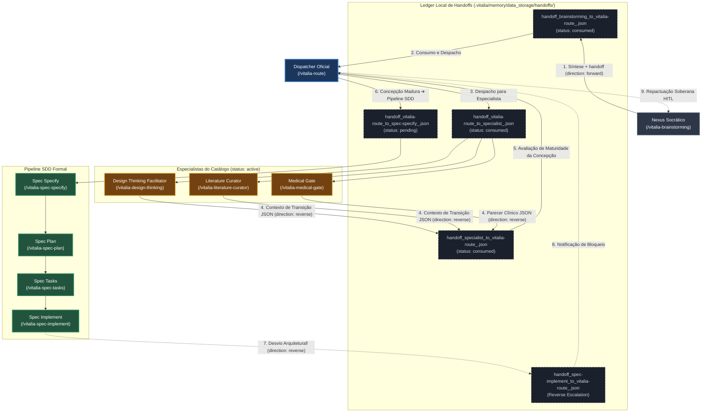
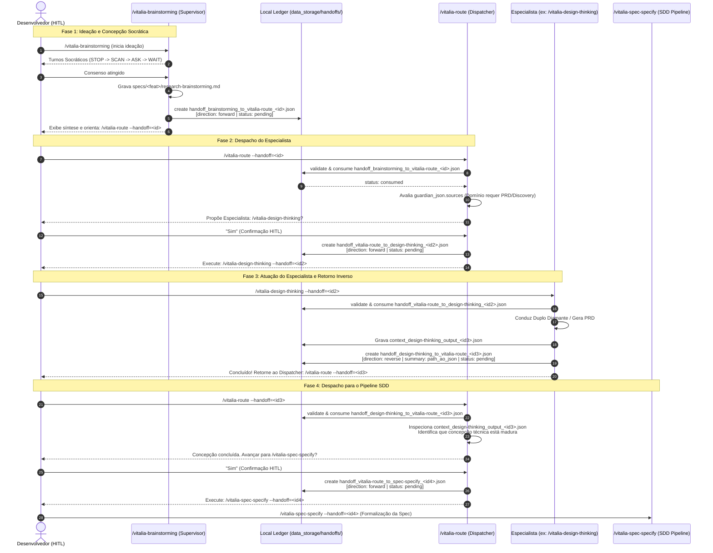
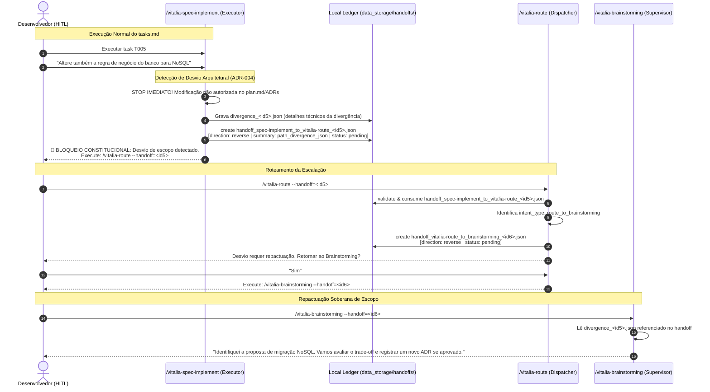
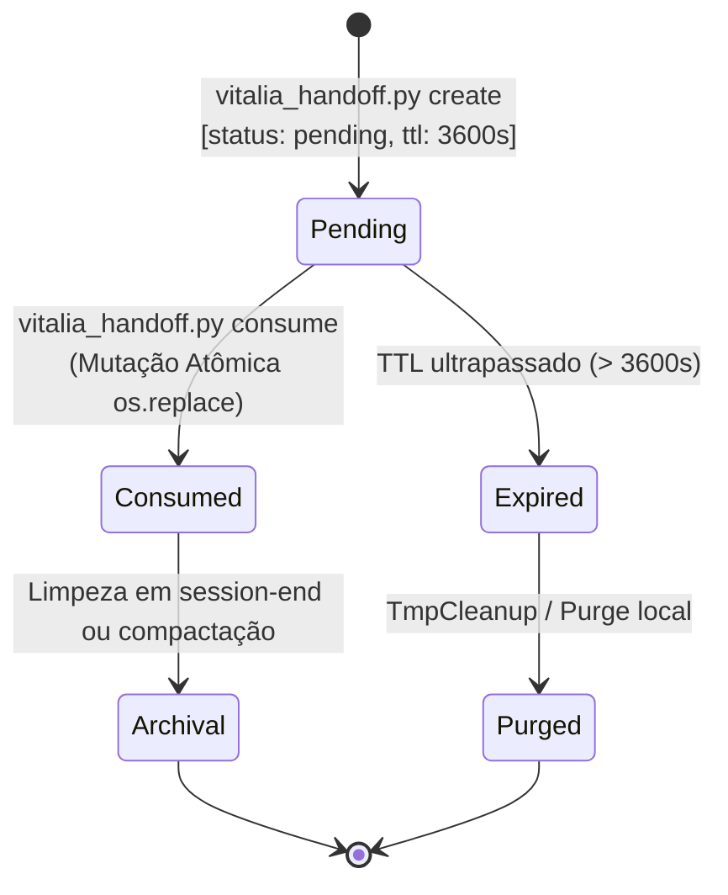

<!-- handoff_transition_topology.md | Vitalia SDD v0.6.0 | 18-10-2026 00:25(GMT-04:00) -->
# Topologia de Handoff, Transição Bidirecional e Nomenclatura de Contexto

**Data:** 18-10-2026 00:25(GMT-04:00)  
**Feature:** `kit-routing-subagents`  
**Status:** ALINHAMENTO ARQUITETURAL  
**Contratos Atendidos:** ADR-001, ADR-002, ADR-003, ADR-004, ADR-005, ADR-006

---

## 1. Visão Geral da Topologia Bidirecional

O sistema de handoff do Vitalia Kit opera como uma malha determinística e segura em sistema de arquivos local (`.vitalia/memory/data_storage/handoffs/`), sem dependência de daemons externos (Zero Redis), governado por duas rotas de tráfego complementares:

1. **Fluxo Progressivo (Forward Flow):**  
   `Brainstorming (Supervisor)` ➔ `vitalia-route (Dispatcher)` ➔ `Especialista do Catálogo` ➔ `vitalia-route` ➔ `Pipeline SDD (spec-specify)`.
2. **Fluxo Regressivo / Escalação Invertida (Reverse Flow):**  
   `Agente Executor (spec-implement / pair)` ➔ `vitalia-route` ➔ `Brainstorming (Supervisor)` para repactuação soberana HITL de desvios arquiteturais.
3. **Fallback com Preservação de Contexto (Fallback Flow):**  
   `vitalia-route` ➔ `Brainstorming` quando uma entrada do usuário ou sub-agente for ambígua ou exigir clarificação socrática prévia.

---

## 2. Nomenclatura Semântica dos Arquivos no Filesystem

Para garantir rastreabilidade visual, auditoria e prevenção de colisão em concorrência multi-processo, os arquivos físicos abandonam nomes genéricos e adotam a convenção canônica baseada nos componentes da transição:

```text
.vitalia/memory/data_storage/handoffs/
  ├── handoff_brainstorming_to_vitalia-route_<uuid>.json
  ├── handoff_vitalia-route_to_design-thinking_<uuid>.json
  ├── handoff_design-thinking_to_vitalia-route_<uuid>.json
  ├── handoff_vitalia-route_to_spec-specify_<uuid>.json
  ├── handoff_spec-implement_to_vitalia-route_<uuid>.json
  └── handoff_vitalia-route_to_brainstorming_<uuid>.json
```

### Regra de Formação do Nome:
`handoff_<source_workflow>_to_<target_workflow>_<uuid_8>.json`
- `<source_workflow>`: Basename da extensão emissora (ex: `brainstorming`, `spec-implement`).
- `<target_workflow>`: Basename da extensão receptora (ex: `vitalia-route`, `design-thinking`).
- `<uuid_8>`: Prefixo de 8 caracteres do UUID v4 gerado para a transição.

---

## 3. Direção da Transição e Semântica de `normalized_summary`

No schema `vitalia-handoff-v1.0.0.json`, o campo `envelope.direction` e o campo `intent.normalized_summary` assumem papéis estritos:

| Sentido do Fluxo | `envelope.direction` | `intent.intent_type` | Conteúdo de `intent.normalized_summary` |
|---|---|---|---|
| **Forward: Brainstorming ➔ Route** | `forward` | `brainstorming_to_route` | Caminho do artefato Markdown: `specs/<feat>/research-brainstorming.md` |
| **Forward: Route ➔ Especialista** | `forward` | `route_dispatch` | Instrução de ativação do especialista com referência ao contexto inicial |
| **Reverse: Especialista ➔ Route** | `reverse` | `subagent_response` | Caminho do arquivo JSON com o contexto de transição exportado pelo especialista: `.vitalia/memory/data_storage/handoffs/context_<especialista>_output_<uuid>.json` |
| **Forward: Route ➔ SDD Specify** | `forward` | `sdd_pipeline_advance` | Caminho do artefato consolidado final (PRD ou Síntese) pronto para especificação formal |
| **Reverse: Implement ➔ Route** | `reverse` | `route_to_brainstorming` | Caminho do arquivo JSON com o diagnóstico da divergência: `.vitalia/memory/data_storage/handoffs/divergence_<uuid>.json` |
| **Fallback: Route ➔ Brainstorming**| `fallback`| `route_to_brainstorming` | Resumo textual (até 120 chars) do motivo da necessidade de ideação |

---

## 4. Diagramas Mermaid de Alinhamento

### 4.1. Topologia de Roteamento Completa (Forward & Reverse)



---

### 4.2. Diagrama de Sequência: Ciclo Completo com Especialista e Retorno Inverso



---

### 4.3. Diagrama de Sequência: Escalação Invertida (Reverse Flow por Desvio de Escopo)



---

## 5. Matriz de Estados do Arquivo no Filesystem



---

## 6. Atualização dos Contratos nos Arquivos TOML

Com este alinhamento formalizado:
1. `source/extensions/brainstorming.toml`:
   - Ao finalizar, gera `specs/<feat>/research-brainstorming.md`;
   - Emite `vitalia_handoff.py create` gerando `handoff_brainstorming_to_vitalia-route_<uuid>.json` com `direction: "forward"`.
2. `source/extensions/vitalia-route.toml`:
   - Inspeciona `direction` e `normalized_summary` (caminho do JSON/Markdown de contexto);
   - Se veio de especialista (`direction: "reverse"` com `intent_type: "subagent_response"`), avalia o JSON emitido pelo especialista. Se a concepção estiver madura, despacha para `/vitalia-spec-specify`;
   - No fallback Nível 3, emite `handoff_vitalia-route_to_brainstorming_<uuid>.json` com `direction: "fallback"`.
3. `source/extensions/spec-implement.toml` e `pair.toml`:
   - Ao identificar desvio, gravam os detalhes da divergência em `divergence_<uuid>.json` e emitem `handoff_spec-implement_to_vitalia-route_<uuid>.json` com `direction: "reverse"` e `intent_type: "route_to_brainstorming"`.
