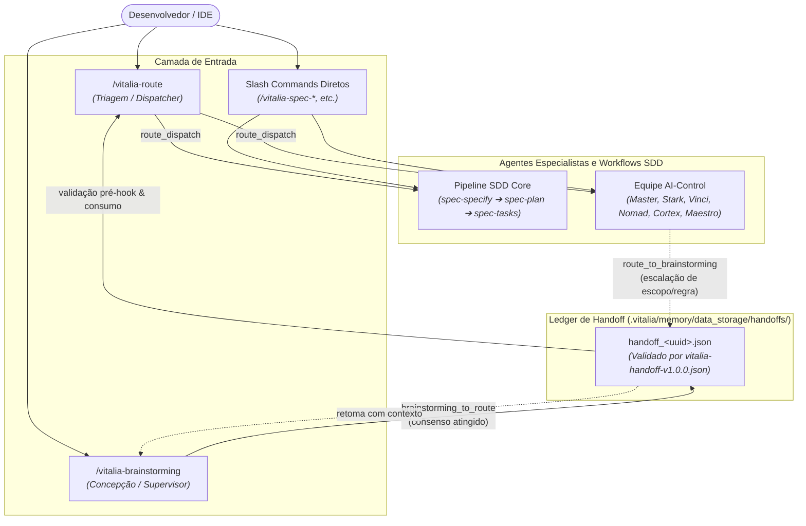

<!-- research-brainstorming.md | Vitalia SDD v0.6.0 | 20-10-2026 09:20(GMT-04:00) -->
> **research-brainstorming.md | Vitalia SDD v0.6.0 | 20-10-2026 09:20(GMT-04:00)**

# Registro de Concepção e Brainstorming: Roteamento Inteligente, Handoff Local Seguro e Acionamento de Agentes

## 1. Resumo Executivo das Decisões Tomadas

Nesta sessão de brainstorming foi alinhada a arquitetura definitiva para resolver os problemas de roteamento, ausência de primitivas de handoff, falsas alegações de streams Redis e agentes puramente declarativos identificados na auditoria técnica [`kit_routing_audit.md`](file:///home/andre/projetos/assistidos/kit_src/specs/sdd-judge-distributed/kit_routing_audit.md) (achados A1 a A11).

### Decisão 1: Persistência Local e Soberania de Dados (Zero Data Leak)
- **Congelamento do Redis:** O transporte inter-agente não depende de conexões ou filas Redis (`vitalia:handoffs`, `vitalia:agents:*`) nesta fase. Todo o trânsito é realizado localmente no filesystem do projeto.
- **Localização Estrita em `data_storage`:** Elimina qualquer escrita de contexto em pastas globais (`~/.vitalia/tmp` ou `/tmp`). Os payloads transacionais de handoff residem exclusivamente dentro do repositório em:
  ```text
  .vitalia/memory/data_storage/handoffs/handoff_<uuid>.json
  ```
- **Conformidade Constitucional (P02, P12):** Garante isolamento entre projetos e impede que dados confidenciais ou metadados de features vazem para o sistema de arquivos global do sistema operacional.

### Decisão 2: Topologia de Roteamento Desacoplada e Bidirecional
- **Desacoplamento do Brainstorming:** O `/vitalia-brainstorming` foca exclusivamente na facilitação socrática e descoberta de escopo. Ele não processa roteamento final. Ao atingir o consenso, emite um artefato de handoff estruturado para o `/vitalia-route`.
- **Papel do `vitalia-route`:** O `/vitalia-route` é o despachante oficial do kit. Ele avalia a intenção recebida contra a `routing_table.yaml` (Nível 1 - palavras-chave) e `brainstorming_intents.yaml` (Nível 2 - semântica) e direciona para o agente ou workflow competente.
- **Liberdade de Invocação Direta:** O desenvolvedor permanece com a prerrogativa de acionar diretamente qualquer agente ou workflow via *slash command* a qualquer momento na IDE.
- **Fluxo Invertido de Escalação (`route_to_brainstorming`):** Quando a conversação com um agente especialista (ex: time AI-Control) extrapola sua especificidade técnica ou envolve novas regras de negócio / arquitetura, o especialista emite formalmente um handoff de escalação de volta para o `/vitalia-route` (ou diretamente para o `/vitalia-brainstorming`), garantindo que o Brainstorming retome o contexto sem cold start.

### Decisão 3: Saneamento do Catálogo e Nomenclaturas
- **Status Operacional (`status: active | planned`):**
  - **`active`:** Workflows e agentes com arquivos `.toml` executáveis e `SKILL.md` instalados.
  - **`planned`:** Agentes mapeados na taxonomia do ecossistema, mas cujos TOMLs executáveis ainda serão implementados.
- **Ingestão da Família AI-Control:** O `agents_catalog.yaml` incorpora formalmente os 6 agentes especialistas extraídos de `AI-Control completo.md`:
  1. `Master AI-Control` (Arquiteto e Maestro)
  2. `Django-Stark` (Especialista Backend Python/Django/Celery/DRF)
  3. `React-Vinci` (Especialista Frontend Next.js/TypeScript/Tailwind/UI)
  4. `Infra-Nomad` (Especialista DevOps/Docker/CI/CD/Ambientes)
  5. `Cortex-Analyst` (Especialista em Dados/IA/Embeddings/RAG)
  6. `Figma-Maestro` (Especialista em Design System/UX)
  *Inicialmente registrados como `status: planned` até a criação dos seus respectivos `.toml`.*
- **Correção no Instalador (`install-project`):** Elimina o bug que gerava comandos duplicados `vitalia-vitalia-route` e `vitalia-vitalia-integrative-review`, higienizando a extração do nome base antes de aplicar o prefixo.
- **Respeito ao Token Budget e Equalização por Hardware Profile (ADR-006):** O `GuardianContextV2` aplica seu subsistema nativo de equalização proporcional de contexto (`total_budget` e `source_weights`). Os adaptadores (`RoutingTableAdapter`, `AgentsCatalogAdapter`, `BrainstormingIntentsAdapter`) respeitam a cota `src_token_limit` aplicando poda semântica sensível ao `hardware_profile`: limite estrito de até 1.000 tokens para execuções locais/leves (prevenindo OOM e alucinação no Ollama Qwen2.5 3B) e orçamento expandido de até 4.000 tokens para o perfil `frontier` na IDE (preservando o contexto rico para modelos de fronteira).

### Decisão 4: Validação Programática Pré-Hook e Ingestão Transparente
- **Validação de Schema Pré-Invocação:** O schema [`vitalia-handoff-v1.0.0.json`](file:///home/andre/projetos/assistidos/kit_src/source/src/schemas/vitalia-handoff-v1.0.0.json) é o contrato obrigatório. Um script Python pré-hook valida os payloads de handoff usando `jsonschema`. Payloads inválidos são bloqueados antes de atingir o LLM (eliminando a alucinação de handoff - risco P12).
- **Ingestão Transparente via `--args`:** O `vitalia_hook_runner.py` inspeciona argumentos recebidos e carrega o arquivo referenciado por `--handoff=<id>` diretamente em `session_context.handoff` dentro do `guardian_json`, sem quebrar a assinatura dos 25 arquivos `SKILL.md` existentes.
- **Ciclo de Vida do Handoff:** O pré-hook atualiza atomicamente `envelope.status` de `"pending"` para `"consumed"` assim que o workflow de destino consome o arquivo com sucesso.

---

## 2. Rastro de Pesquisa e Grounding (P03)

| # | Afirmação Técnica | Verificado? | Fonte / Evidência | Data |
|---|---|:---:|---|:---:|
| 1 | Padrão Supervisor vs Handoff em sistemas multi-agentes requer separação clara entre triagem (dispatcher) e especialistas | Sim | Repositórios *LangGraph Supervisor* (`langchain-ai/langgraph-supervisor-py`) e *OpenAI Agents SDK / Swarm* | 16-10-2026 |
| 2 | Em IDEs agênticas (Claude Code / Antigravity), context isolation via subagentes com handoffs estruturados previne degradação por ruído ("lost in the middle") | Sim | Arquitetura oficial de sub-agentes e skills do Claude Code e Antigravity IDE Framework | 16-10-2026 |
| 3 | Afirmações fictícias de escrita em canais inexistentes violam integridade de output agêntico | Sim | Diretrizes OWASP Top 10 for LLMs (LLM01 / LLM07) e Princípio Constitucional Vitalia P12 | 16-10-2026 |
| 4 | O schema `vitalia-handoff-v1.0.0.json` já previa `brainstorming_to_route`, `route_to_brainstorming` e `route_dispatch` | Sim | Código verificado em `source/src/schemas/vitalia-handoff-v1.0.0.json` | 16-10-2026 |
| 5 | Validação de schema no pré-hook antes da inferência assegura determinismo de transição inter-agente | Sim | Padrões de validação via `jsonschema` na biblioteca padrão/PyPI e hooks do Guardian (§11) | 16-10-2026 |

---

## 3. Topologia Operacional do Fluxo de Roteamento



---

## 4. Contratos Técnicos e Especificações Operacionais (Anti-Alucinação para a Spec)

Para assegurar que a fase de especificação (`/vitalia-spec-specify`) seja determinística e não dependa de suposições do LLM, os seguintes contratos operacionais ficam fixados:

### 4.1. Módulo Utilitário Python: `source/src/vitalia_handoff.py`
Para evitar que o LLM tenha que gerar JSONs complexos ou invocar comandos inexistentes, o kit fornecerá um script CLI e biblioteca Python dedicado:
- **Localização:** `source/src/vitalia_handoff.py` (sincronizado para `~/.vitalia/src/vitalia_handoff.py`).
- **Comandos CLI:**
  ```bash
  # Criação programática de handoff com validação embutida
  python3 ~/.vitalia/src/vitalia_handoff.py create \
    --source "brainstorming" \
    --target "vitalia-route" \
    --intent-type "brainstorming_to_route" \
    --input "Refatoração do roteador e catálogo" \
    --summary "Consenso alcançado sobre handoff local e time AI-Control" \
    --confidence 0.95 \
    --domain "arquitetura" \
    --feature "specs/kit-routing-subagents"

  # Validação estrita contra o schema
  python3 ~/.vitalia/src/vitalia_handoff.py validate <caminho_ou_id>

  # Consumo e transição de estado atômica
  python3 ~/.vitalia/src/vitalia_handoff.py consume <caminho_ou_id>
  ```
- **Resolução de Metadados Automáticos:** O helper resolve automaticamente `handoff_id` (UUID v4), `created_at` (ISO8601 no fuso GMT-04:00), `machine_id` (SHA256[:8] do hostname ou VITALIA_MACHINE_NAME), `ttl_seconds: 3600` e grava em `.vitalia/memory/data_storage/handoffs/handoff_<uuid>.json`.

### 4.2. Declaração de Ferramentas nos Workflows (`[tools]`)
- No `vitalia-route.toml`, `brainstorming.toml` e futuros TOMLs de agentes:
  ```toml
  [tools]
  required = ["read_file", "write_file"]
  optional = ["run_command"]
  ```
  Isso dá à IA a capacidade explícita de gravar o arquivo de handoff via `write_file` ou executar o utilitário `vitalia_handoff.py` sem violação de permissões de ferramentas na IDE.

### 4.3. Contrato de Injeção no `guardian_json`
- **Ponto Canônico:** `guardian_json.session_context.handoff`
- **Comportamento no `GuardianContextV2` (`guardian_context.py`):**
  1. Examina se `user_args` contém `--handoff=<valor>` ou se foi passado o nome de um arquivo em `data_storage/handoffs/`.
  2. Se encontrado, valida o arquivo com `vitalia_handoff.py validate`.
  3. Se válido:
     - Executa a marcação de consumo (`envelope.status = "consumed"`).
     - Injeta o dicionário completo do handoff em `session_context.handoff`.
  4. Se não encontrado:
     - Define `session_context.handoff = null`.
- **Comportamento do Prompt do `vitalia-route.toml`:**
  - Se `session_context.handoff` não for nulo: processa a intenção já sintetizada e formalizada, exibindo a sugestão de roteamento com base nos dados do handoff.
  - Se for nulo: faz a triagem da entrada textual do usuário (`session_context.user_input`).

### 4.4. Mapeamento Canônico da Equipe AI-Control no `agents_catalog.yaml`
Os 6 agentes devem ser inseridos com a seguinte estrutura padronizada (todos com `status: planned`):
```yaml
  - id: "master-ai-control"
    name: "Master AI-Control"
    emoji: "👑"
    status: "planned"
    gates: ["route", "session-start", "session-end"]
    command: "/vitalia-master-ai-control"
    role: "Arquiteto de Soluções e Tech Lead Sênior"
    model_hint: "frontier"
    sub_agents: ["stark", "vinci", "nomad", "cortex", "maestro"]
    data_inputs: [{"type": "epic_description"}]
    data_outputs: [{"type": "architecture_blueprint", "format": "markdown"}]
    queue_key: "vitalia:agents:master-ai-control"
    description: "Arquiteto e Maestro do ecossistema AI-Control. Traduz requisitos de negócio em arquitetura multi-tenant robusta e planos atômicos."

  - id: "django-stark"
    name: "Django-Stark"
    emoji: "⚡"
    status: "planned"
    gates: ["route"]
    command: "/vitalia-django-stark"
    role: "Especialista Backend Django, DRF e Celery"
    model_hint: "frontier"
    sub_agents: []
    data_inputs: [{"type": "api_contract"}]
    data_outputs: [{"type": "code", "format": "python"}]
    queue_key: "vitalia:agents:django-stark"
    description: "Engenheiro Backend especialista em Django 5, DRF, Celery, PostgreSQL 16 com pgvector, RBAC estrito e isolamento multi-tenant."

  - id: "react-vinci"
    name: "React-Vinci"
    emoji: "🎨"
    status: "planned"
    gates: ["route"]
    command: "/vitalia-react-vinci"
    role: "Especialista Frontend Next.js e TypeScript"
    model_hint: "frontier"
    sub_agents: []
    data_inputs: [{"type": "figma_tokens"}, {"type": "api_contract"}]
    data_outputs: [{"type": "code", "format": "typescript"}]
    queue_key: "vitalia:agents:react-vinci"
    description: "Engenheiro Frontend especialista em Next.js (App Router), TypeScript, Tailwind CSS, shadcn/ui e TanStack Query."

  - id: "infra-nomad"
    name: "Infra-Nomad"
    emoji: "🏗️"
    status: "planned"
    gates: ["route"]
    command: "/vitalia-infra-nomad"
    role: "Especialista DevOps, Docker e Infraestrutura"
    model_hint: "lightweight"
    sub_agents: []
    data_inputs: [{"type": "environment_config"}]
    data_outputs: [{"type": "docker_compose"}, {"type": "ci_pipeline"}]
    queue_key: "vitalia:agents:infra-nomad"
    description: "Guardião da infraestrutura conteinerizada, Docker Compose, redes seguras, volumes persistentes e pipelines de entrega contínua."

  - id: "cortex-analyst"
    name: "Cortex-Analyst"
    emoji: "🧠"
    status: "planned"
    gates: ["route"]
    command: "/vitalia-cortex-analyst"
    role: "Especialista em Dados, IA e RAG"
    model_hint: "heavy"
    sub_agents: []
    data_inputs: [{"type": "document_stream"}]
    data_outputs: [{"type": "vector_embeddings"}]
    queue_key: "vitalia:agents:cortex-analyst"
    description: "Especialista em pipelines de ingestão de dados, chunking, modelos de embeddings locais/cloud e busca vetorial com pgvector."

  - id: "figma-maestro"
    name: "Figma-Maestro"
    emoji: "✨"
    status: "planned"
    gates: ["route"]
    command: "/vitalia-figma-maestro"
    role: "Especialista em Design System e UX"
    model_hint: "lightweight"
    sub_agents: []
    data_inputs: [{"type": "wireframe"}]
    data_outputs: [{"type": "design_tokens"}]
    queue_key: "vitalia:agents:figma-maestro"
    description: "Arquiteto de interfaces, design tokens, micro-interações, acessibilidade e componentes visuais do ecossistema."
```

### 4.5. Correção Idempotente no Instalador (`source/bin/install-project`)
Para corrigir de forma definitiva o problema de duplicação de prefixos (A3):
- **Trecho Problemático Atual (linhas 179-180):**
  ```bash
  ext_name=$(basename "${toml_file}" .toml)
  skill_name="vitalia-${ext_name}"
  ```
- **Substituição Obrigatória:**
  ```bash
  ext_name=$(basename "${toml_file}" .toml)
  clean_name=$(echo "${ext_name}" | sed 's/^vitalia-//')
  skill_name="vitalia-${clean_name}"
  ```
  Isso assegura que `vitalia-route.toml` vire `vitalia-route/SKILL.md` (e comando `/vitalia-route`), e que `vitalia-integrative-review.toml` vire `vitalia-integrative-review/SKILL.md` (e comando `/vitalia-integrative-review`).

---

## 6. Resolução das Divergências da Auditoria de Conformidade (20-10-2026)

Após auditoria técnica formal confrontando o Kit ativo vs a Spec, foram ratificadas as seguintes deliberações de alinhamento consensual com o desenvolvedor:

1. **Equipe AI-Control (FR-009):** Purga imediata dos especialistas clínicos inseridos por equívoco no catálogo. Ingestão exclusiva dos 6 especialistas oficiais de engenharia e produto do ecossistema AI-Control (`master-ai-control`, `django-stark`, `react-vinci`, `infra-nomad`, `cortex-analyst`, `figma-maestro`) com `status: "planned"`.
2. **Governança de Status Operacional (FR-008):** Aplicação da regra estrita onde apenas workflows com manifesto `.toml` real e funcional em `extensions/` recebem `status: "active"`. Agentes sem extensão executável (`design-thinking`, `literature-curator`, `visual-creator`, `architect`) passam compulsoriamente a `status: "planned"`.
3. **Idempotência e Expurgamento no Instalador (FR-010 / T021):** O `install-project` adota normalização por regex recursiva `sed -E 's/^(vitalia-)+//'` e rotina explícita que move qualquer pasta órfã ou duplicada (`vitalia-vitalia-*`) para `.trash/` antes de gerar novas skills, procedendo com a atualização do repositório consumidor `ai-control`.
4. **Padrão de Cabeçalho Visível em Markdown:** Todo arquivo `.md` criado ou alterado passa a exibir o carimbo temporal de identificação repetido na segunda linha, garantindo legibilidade tanto no código-fonte quanto no modo de visualização renderizado na IDE.

