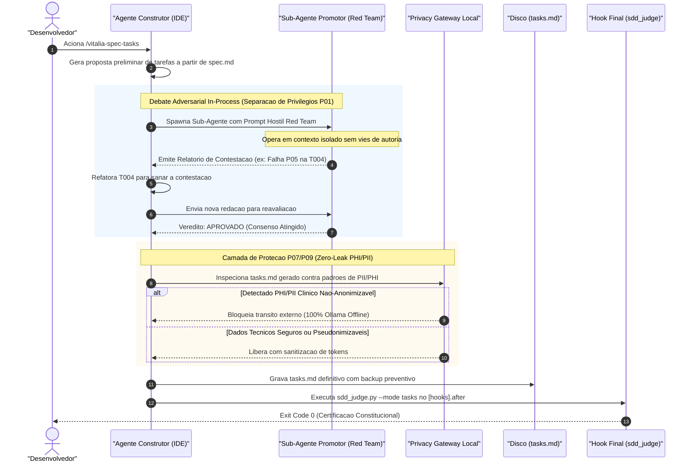

<!-- adversarial_subagent_architecture.md | Vitalia SDD v0.6.0 | 16-10-2026 13:27(GMT-04:00) -->

# Fluxo Arquitetural: Sub-Agente Adversarial e Privacy Gateway (Vitalia SDD v0.6.0)

Este documento detalha o funcionamento do **Sub-Agente Promotor Constitucional (Red Team)** operando em conjunto com o **Privacy Proxy Gateway Local**, garantindo separação de privilégios e proteção estrita de PII/PHI.

---

## 1. Diagrama de Sequência: Agente Construtor vs. Sub-Agente Red Team

---

## 2. Princípios Constitucionais Atendidos

1. **P01 (SDD Pipeline Inviolability & Separation of Concerns):** O agente que constrói o código não é o único validador de si mesmo. O Sub-Agente atua como auditor externo independente.
2. **P07 (Data Sovereignty) & P09 (Clinical Safety Gate):** O Privacy Gateway analisa o payload antes de qualquer trânsito na rede. Dados sensíveis de saúde nunca saem do ambiente local.
3. **P11 (Hardware Agnosticism):** Modelos e parâmetros são resolvidos dinamicamente via `.env`, preservando o funcionamento em qualquer hardware ou provedor.
4. **P12 (Agent Security & Constrained Output):** Todos os vereditos entre o Sub-Agente e o Agente Principal utilizam schemas JSON formais, anulando alucinações de recusa ou comandos malformados.
