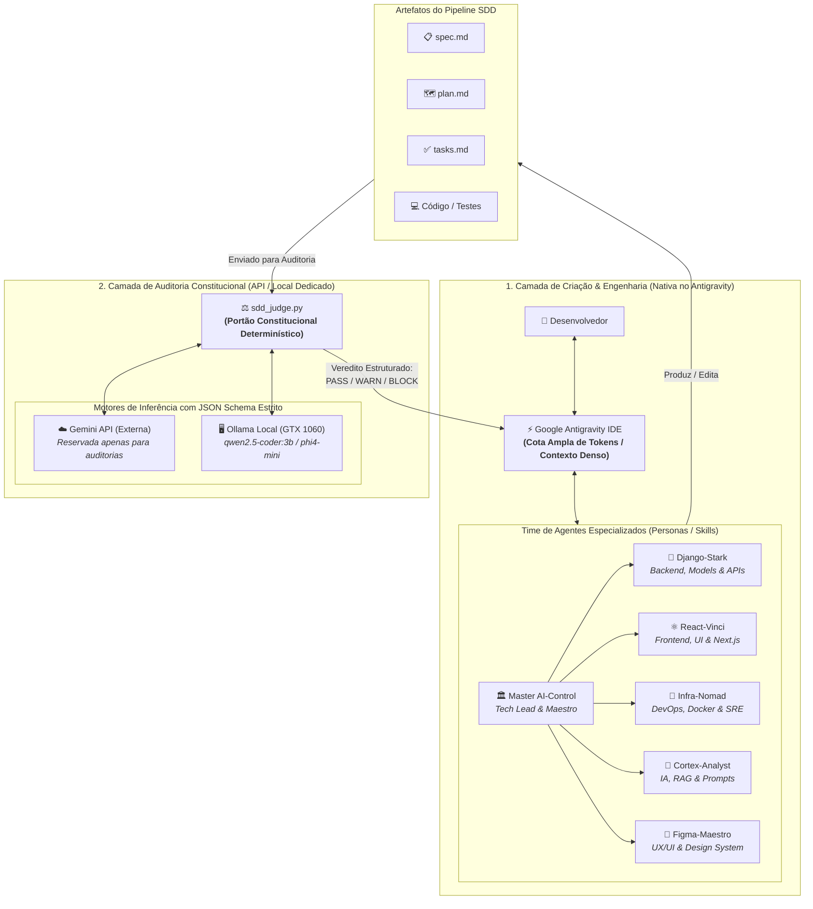
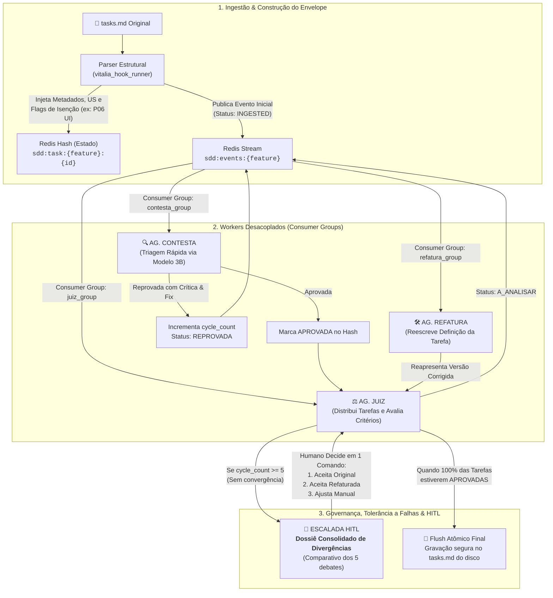

<!-- architecture-diagrams.md | Vitalia SDD v0.6.0 | 15-10-2026 18:38(GMT-04:00) -->
# Diagramas de Arquitetura: SDD Judge Distribuído & Segregação de Camadas

**Data:** 15-10-2026 18:38(GMT-04:00)  
**Feature:** `sdd-judge-distributed`  
**Documentos Relacionados:**
- [research-brainstorming.md](file:///home/andre/projetos/assistidos/kit_src/specs/sdd-judge-distributed/research-brainstorming.md)
- [kit_routing_audit.md](file:///home/andre/projetos/assistidos/kit_src/specs/sdd-judge-distributed/kit_routing_audit.md)

---

## 1. Segregação de Camadas por Cota de Tokens (IDE vs API Externa)

Este diagrama detalha a divisão entre a **cota ampla da IDE Antigravity** (onde o time de engenharia trabalha) e a **cota restrita de API** (reservada exclusivamente para validação constitucional sintética).



---

## 2. Orquestração Multi-Agente do SDD Judge via Redis Streams

Este diagrama ilustra a máquina de estados (FSM), a fila assíncrona desacoplada via Redis Streams com Consumer Groups, e a salvaguarda de **5 ciclos com escalada para HITL**.



---

## 3. Fluxo Ponta a Ponta: Ciclo SDD com o Time de Agentes e os Gates

```mermaid
sequenceDiagram
    autonumber
    actor Dev as 👤 Desenvolvedor
    participant IDE as ⚡ Antigravity (Master + Time)
    participant Redis as 📬 Redis Streams & Hashes
    participant Judge as ⚖️ SDD Judge (API / Ollama)
    participant Disk as 💾 Filesystem (Disco)

    Note over Dev,IDE: FASE 1: Concepção & Planejamento (Dentro da IDE)
    Dev->>IDE: Aciona /vitalia-spec-specify ou /vitalia-spec-plan
    IDE->>IDE: Master AI-Control convoca Stark (Back) e Vinci (Front)
    IDE->>Disk: Grava spec.md e plan.md

    Note over IDE,Judge: FASE 2: Geração & Auditoria de Tarefas (tasks.md)
    Dev->>IDE: Aciona /vitalia-spec-tasks
    IDE->>Disk: Gera rascunho de tasks.md
    IDE->>Redis: Ingestão de tarefas e Envelopes Antialucinação
    
    loop Loop de Contestação e Refatoração (Até 5 ciclos)
        Redis->>Judge: Agente CONTESTA avalia envelope da tarefa
        alt Aprovada de primeira
            Judge->>Redis: Status: APROVADA
        else Divergência / Reprovação
            Judge->>Redis: Status: REPROVADA + Sugestão de Fix
            Redis->>Judge: Agente REFATURA ajusta semântica da tarefa
            Judge->>Redis: Re-avaliação pelo Agente JUIZ
        end
    end

    opt Excesso de Ciclos (cycle_count >= 5)
        Redis->>Dev: Escalada HITL com Dossiê Consolidado
        Dev->>Redis: Decisão humana rápida injetada no Stream
    end

    Redis->>Disk: Flush atômico final no tasks.md aprovado

    Note over Dev,Disk: FASE 3: Implementação (Dentro da IDE)
    Dev->>IDE: Aciona /vitalia-spec-implement
    IDE->>IDE: Stark implementa backend, Vinci implementa frontend
    IDE->>Judge: after_task gate valida conformidade antes de commitar
