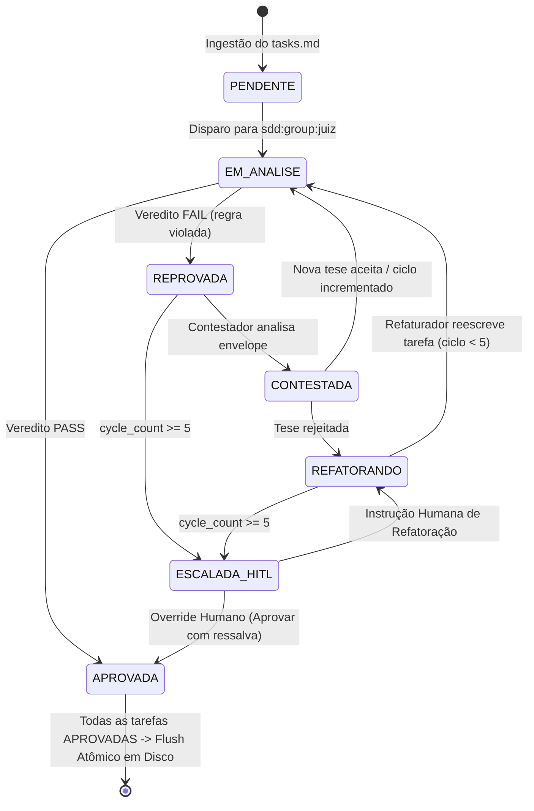

<!-- data-model.md | Vitalia SDD v0.6.0 | 15-10-2026 20:30(GMT-04:00) -->

# Modelo de Dados: sdd-judge-distributed

## 1. Visão Geral
Este documento especifica as estruturas de dados, esquemas e ciclos de vida de entidades manipuladas pelo pipeline distribuído de julgamento de tarefas (`sdd-judge-distributed`).

Toda a mutação de estado durante os ciclos de julgamento, contestação e refatoração ocorre exclusivamente em memória de trabalho (Redis Hashes e Redis Streams). O disco físico (`tasks.md`) permanece intacto até que 100% das tarefas atinjam o status terminal de aprovação (`APROVADA`), eliminando corrupção parcial de arquivos e loops de I/O em disco.

---

## 2. Declarações Constitucionais
- **P02 (Impacto Direto ao Usuário):** A transição de estado estritamente em memória protege o desenvolvedor de perdas de tarefas mal formatadas ou commits corrompidos durante iterações de IA, garantindo idempotência e reversibilidade total.
- **P07 / P09 (Privacidade e Domínio Clínico):** Não aplicável. Este modelo armazena metadados técnicos de engenharia de software (IDs de tarefas, nomes de arquivos, descrições e flags sintáticas). Não processa dados pessoais sensíveis (LGPD) nem dados clínicos de pacientes.
- **P11 (Agnosticismo de Infraestrutura):** As estruturas utilizam primitivas padrão do protocolo Redis (Hashes, Streams e Consumer Groups), compatíveis com instâncias locais em container Docker, Redis standalone ou clusters distribuídos via variável `REDIS_URL`.

---

## 3. Estruturas no Redis

### 3.1 Hash de Estado da Tarefa: `sdd:task:{feature}:{task_id}`

Cada tarefa individual do `tasks.md` é representada por um Redis Hash unívoco indexado por feature e task ID.

| Campo | Tipo | Descrição | Exemplo |
| :--- | :--- | :--- | :--- |
| `task_id` | String | Identificador atômico da tarefa | `"T003"` |
| `feature` | String | Slug da especificação ativa | `"sdd-judge-distributed"` |
| `phase` | String | Nome da fase de execução | `"Fase 2: Motor Redis & FSM"` |
| `user_story` | String | Tag da User Story de referência | `"US2"` |
| `is_parallel` | Boolean (0/1) | Flag `[P]` indicando independência paralela | `1` |
| `status` | Enum | Estado corrente na FSM | `"PENDENTE"`, `"EM_ANALISE"`, `"APROVADA"`, `"REPROVADA"`, `"ESCALADA_HITL"` |
| `cycle_count` | Integer | Contador de iterações no loop juiz-contestador | `2` |
| `max_cycles` | Integer | Limite superior antes da escalação HITL | `5` |
| `envelope` | JSON String | Envelope contextual completo contra alucinação | *(Ver seção 4.1)* |
| `history` | JSON String | Array de histórico de adjudicações e correções | *(Ver seção 4.2)* |
| `suggested_fix`| String | Proposta corrente de redação da tarefa formulada pelo Refaturador | `"- [ ] T003 [P] [US2] Criar consumer group..."` |
| `escalation_reason` | String | Justificativa técnica ao disparar HITL | `""` ou `"Deadlock de regras P05 e P06 após 5 ciclos"` |
| `created_at` | String | Timestamp ISO-8601 de ingestão | `"2026-10-15T20:30:00Z"` |
| `updated_at` | String | Timestamp ISO-8601 da última transição | `"2026-10-15T20:32:15Z"` |

**TTL da Chave:** 86.400 segundos (24 horas) a partir da última atualização, renovado a cada mutação.

---

### 3.2 Stream de Eventos Distribuídos: `sdd:events:{feature}`

Canal append-only para comunicação assíncrona entre o Orquestrador e os nós julgadores.

#### Campos de cada mensagem no Stream:
- `event_id`: Identificador gerado pelo Redis (`<timestamp>-<sequence>`).
- `event_type`: Categoria do evento (`TASK_INGESTED`, `TASK_EVALUATE`, `TASK_ADJUDICATED`, `TASK_CONTESTED`, `TASK_REFACTORED`, `TASK_APPROVED`, `TASK_ESCALATED`, `HITL_OVERRIDE`).
- `task_id`: ID da tarefa referenciada (ex: `"T002"`).
- `producer`: Identificador do componente emissor (ex: `"orchestrator"`, `"juiz_worker_1"`, `"refatorador_worker_1"`).
- `payload`: JSON string contendo os dados específicos do evento.
- `timestamp`: Timestamp ISO-8601 da publicação.

#### Consumer Groups Configurados:
1. `sdd:group:juiz` — Consome eventos `TASK_INGESTED` e `TASK_REFACTORED` para avaliação do Juiz.
2. `sdd:group:contesta` — Consome eventos `TASK_ADJUDICATED` com veredito `REPROVADA`.
3. `sdd:group:refatura` — Consome eventos `TASK_CONTESTED` confirmados para gerar nova redação atômica.
4. `sdd:group:hitl` — Consome eventos `TASK_ESCALATED` para compilar o dossiê e pausar o pipeline.

---

## 4. Esquemas JSON Estruturados

### 4.1 Envelope Anti-Alucinação (`envelope`)

Para evitar que modelos compactos (ex: 3B/3.8B) sofram de viés de contexto isolado, cada tarefa recebe o envelope sintetizado:

```json
{
  "task_id": "T005",
  "raw_line": "- [ ] T005 [P] [US2] Criar serviço RedisStreamConsumer em src/services/consumer.py",
  "phase_name": "Fase 2: Motor Redis & FSM",
  "user_story": {
    "id": "US2",
    "title": "Adjudicação Concorrente via Consumer Groups",
    "acceptance_criteria": [
      "Processar mensagens simultâneas sem race condition",
      "Garantir ACK apenas após validação completa"
    ]
  },
  "target_component": "src/services/consumer.py",
  "test_task_predecessor": {
    "task_id": "T004",
    "raw_line": "- [ ] T004 [P] [US2] Criar testes unitários para RedisStreamConsumer em tests/test_consumer.py",
    "is_completed": false
  },
  "negative_scope_flags": {
    "contains_secrets": false,
    "touches_security_core": false,
    "production_deployment": false
  },
  "contextual_files_referenced": [
    "src/services/consumer.py",
    "tests/test_consumer.py"
  ]
}
```

### 4.2 Histórico de Adjudicação (`history`)

Array mantido dentro do hash da tarefa para auditoria e contexto incremental fornecido ao Contestador e ao Humano:

```json
[
  {
    "cycle": 1,
    "timestamp": "2026-10-15T20:31:00Z",
    "evaluator_model": "qwen2.5-coder:3b",
    "verdict": "REPROVADA",
    "rule_infringed": "P05_TEST_FIRST",
    "reasoning": "A tarefa T005 implementa código produtivo sem evidência de teste prévio.",
    "contest_response": {
      "contested": true,
      "counter_argument": "A tarefa T004 antecede T005 na mesma fase e cria exatamente o teste unitário test_consumer.py.",
      "accepted_by_judge": false
    }
  },
  {
    "cycle": 2,
    "timestamp": "2026-10-15T20:31:30Z",
    "evaluator_model": "qwen2.5-coder:3b",
    "verdict": "APROVADA",
    "rule_infringed": null,
    "reasoning": "Dependência de T004 explicitada no corpo textual da tarefa refatorada.",
    "contest_response": null
  }
]
```

---

## 5. Máquina de Estados Finita (FSM)



---

## 6. Política de Persistência e Flush Atômico

1. **Garantia de Não-Modificação:** O arquivo físico `tasks.md` em disco não sofre nenhuma alteração durante as iterações 1 a N de qualquer tarefa.
2. **Barreira de Sincronização (Sync Barrier):**
   - O Orquestrador verifica periodicamente:
     $$\text{Total Aprovadas} = \sum [status = \text{APROVADA}]$$
   - Se $\text{Total Aprovadas} < \text{Total Tarefas}$, nenhum I/O de escrita em disco é executado.
   - Quando $\text{Total Aprovadas} = \text{Total Tarefas}$, o Orquestrador lê todas as tarefas dos Redis Hashes ordenadas por linha original, recompõe o markdown de `tasks.md` e efetua uma escrita atômica com backup prévio (`tasks.md.bak`).
3. **Session Shard Archiving:**
   - Ao concluir a escrita atômica, o histórico completo de cada hash é exportado para um arquivo de shard em `.vitalia/sessions/shards/sdd-judge-{feature}-{timestamp}.json`.
   - As chaves de trabalho no Redis expiram via TTL configurado.

---

## 7. Diretrizes Críticas de Manipulação de Dados em Baixo Nível (Gotchas)

Para garantir integridade de tipos e evitar falhas de runtime na camada de dados:

1. **Tipagem de Strings UTF-8 (`decode_responses=True`):**
   - Todas as conexões criadas por `services/redis_client.py` devem configurar obrigatoriamente `decode_responses=True`.
   - Sem esta flag, o Redis retorna chaves e valores como `bytes` (`b'...'`), causando falhas imediatas de serialização e asserções de tipo.

2. **Serialização Escalar em Hashes:**
   - Como os Redis Hashes não aceitam estruturas aninhadas, os campos `envelope` e `history` devem ser serializados como string JSON com `json.dumps(..., ensure_ascii=False)` antes do `HSET`.
   - Na recuperação via `HGETALL` ou `HGET`, a desserialização via `json.loads(...)` é obrigatória para restabelecer os dicionários/listas Python originais.
   - O campo `is_parallel` é armazenado como string inteira `"1"` ou `"0"` e convertido com `bool(int(val))`.

3. **Idempotência de Grupos no Stream (`BUSYGROUP` Handling):**
   - A criação de Consumer Groups com `xgroup_create(stream, group, id="$", mkstream=True)` deve capturar a exceção `redis.exceptions.ResponseError` e verificar se a mensagem contém `"BUSYGROUP"`. Caso positivo, o erro é silenciado, garantindo inicialização idempotente dos workers sem travar o processo.

