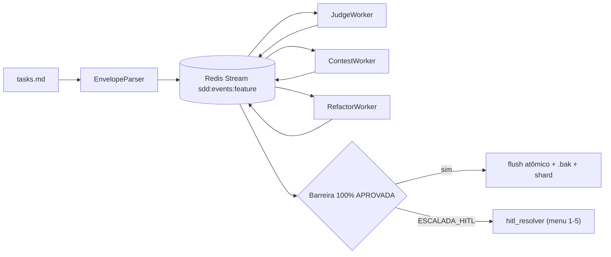

# kit_judge_audit.md | Vitalia SDD v0.6.0 | 16-10-2026 10:22(GMT-04:00)

# Auditoria — `sdd-judge-distributed` (Vitalia Kit 0.6.0)

## O que mudou

A última alteração adicionou o pacote `src/judge/`. Ele substitui o juiz LLM único por um **ciclo adversarial assíncrono**: Juiz → Contestador → Refaturador, ligados por Redis Streams. O estado das tarefas fica em Redis Hashes, há uma barreira de flush atômico e o impasse escala para HITL (intervenção humana) depois de 5 ciclos.

- Repositório de origem: `/home/andre/projetos/assistidos/kit_src`. A feature **não foi commitada** (`?? source/src/judge/`, `specs/`, `tests/`).
- Cópia instalada: `~/.vitalia/src/judge/`, idêntica à origem.
- `tasks.md` da feature: 40/40 marcadas `[X]`. Testes: **32/32 passam**.

## Veredito: implantado no disco, mas **não funcional**

| # | Severidade | Achado | Evidência |
|---|---|---|---|
| 1 | 🔴 CRITICAL | **Quebra na importação dentro do kit instalado.** Todos os módulos importam `from source.src.judge...`, mas `~/.vitalia` não tem pacote `source`. | `ModuleNotFoundError: No module named 'source'` |
| 2 | 🔴 CRITICAL | **Nada está conectado.** Nenhum `.toml` chama `src/judge`. `spec-tasks`, `task-verifier`, `spec-implement` e `converge` continuam chamando o `hooks/sdd_judge.py` legado. | grep em `extensions/` |
| 3 | 🔴 CRITICAL | **Tempestade de eventos.** Os 3 consumer groups leem o mesmo stream e **nenhum worker filtra `event_type`**. O Contestador consome `TASK_APPROVED` e o Refaturador grava `REPROVADA` por cima. Tarefas válidas acabam escaladas para HITL em menos de 1s. | Execução real: T001 (tarefa de teste válida) → `ESCALADA_HITL` no ciclo 5, em 0.7s |
| 4 | 🔴 CRITICAL | **O Refaturador nunca é reavaliado.** O Juiz sempre lê o `envelope` original. O `suggested_fix` não volta para o envelope, então uma reprovação P05 nunca converge. | `judge_worker.py:59`, `refactor_worker.py:99` |
| 5 | 🟡 HIGH | **Não há LLM nenhum.** Os workers guardam `self.model` (`qwen2.5-coder:3b`) mas são só regex: P05 e P06 por padrão de texto. A semântica constitucional do juiz legado se perde. | `judge_worker.py:33-47` |
| 6 | 🟡 HIGH | **Os testes dão falsa confiança.** O teste de "integração" chama `record_adjudication` à mão. `coordinate()` com workers reais **nunca é exercitado**. | `test_integration_quickstart.py` |
| 7 | 🟠 MEDIUM | `--max-cycles` é ignorado: o valor `5` está fixo em `task_store` e `refactor_worker`. `JudgeConfig` não é usado pelos workers. `spec.md` não é passado ao parser. | `distributed_orchestrator.py:55` |
| 8 | 🟠 MEDIUM | O `flush_atomic` casa a linha por `" T00X "`. Isso pode substituir linhas de dependência ou de comentário que citam o ID. | `distributed_orchestrator.py:105` |
| 9 | 🟠 MEDIUM | A dica impressa `python3 -m src.judge.hitl_resolver` está errada (o módulo é `source.src...`). O dossiê rotula "P17", mas P17 na constituição é REGULATORY_COMPLIANCE. | `distributed_orchestrator.py:219` |
| 10 | 🟠 MEDIUM | Valores padrão de modelo fixos no código (`qwen2.5-coder:3b`), contrariando o P11. `kit_src/docker-compose.yml` passou a usar `ollama:latest` (build não reprodutível). | `config.py`, `git diff` |

## O que continua funcionando

- O `hooks/sdd_judge.py` legado (`--mode specify|plan|tasks|after_task|clarify|converge`) está intacto e é o que todos os workflows usam hoje.
- Os componentes isolados funcionam e são bem testados: `TaskStore`, `StreamBroker`, `EnvelopeParser`, `HitlResolver`.

## Efeito colateral da auditoria

Rodei o probe com `--dry-run`, então nenhum disco foi alterado. Ficaram chaves `sdd:task:probe_*` / `sdd:events:probe_*` no Redis local, com TTL de 24h.
