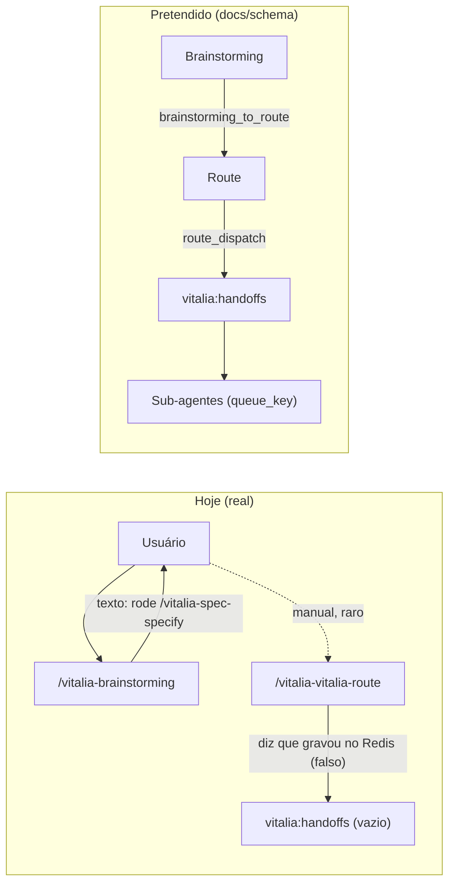

<!-- kit_routing_audit.md | Vitalia SDD v0.6.0 | 15-10-2026 17:05(GMT-04:00) -->
# Auditoria: Roteamento e Acionamento de Sub-Agentes no Vitalia Kit

**Veredito:** Sua impressão está **correta**. O `vitalia-route` nunca é acionado de forma automática e,
mesmo quando é chamado à mão, não aciona nada. O kit hoje **não tem nenhum mecanismo para invocar
sub-agentes**: só há catálogos declarativos e instruções em texto livre para o LLM.

---

## 1. Achados verificados no código

| # | Severidade | Achado | Evidência |
|---|:---:|---|---|
| A1 | 🔴 | **Nenhum caminho de código invoca o route.** Nenhum TOML o declara em `[hooks]`. Nenhum script Python o executa. Nenhum prompt manda rodar o `hook_runner` com `vitalia-route.toml`. | grep `vitalia-route` → aparece só no próprio TOML, em [gp_vitalia-route.yaml](file:///home/andre/projetos/assistidos/kit_src/source/profiles/gp_vitalia-route.yaml) e em um comentário de [guardian_context.py:165](file:///home/andre/projetos/assistidos/kit_src/source/src/hooks/guardian_context.py#L165) |
| A2 | 🔴 | **O brainstorming ("Supervisor") não sabe que o route existe.** O handoff `brainstorming_to_route` existe só em prosa, e o prompt manda o usuário direto para `/vitalia-spec-specify`. Além disso, `routing_table` não está em `yaml_sources` do brainstorming. | [brainstorming.toml:169](file:///home/andre/projetos/assistidos/kit_src/source/extensions/brainstorming.toml#L169) |
| A3 | 🔴 | **O slash command real é `/vitalia-vitalia-route`.** O instalador põe o prefixo `vitalia-` em um arquivo que já se chama `vitalia-route.toml`. O mesmo acontece com o integrative-review, e a `routing_table` já carrega esse nome duplicado. | [install-project:180](file:///home/andre/projetos/assistidos/kit_src/source/bin/install-project#L178-L182), [routing_table.yaml:308](file:///home/andre/projetos/assistidos/kit_src/source/profiles/routing_table.yaml#L308) |
| A4 | 🔴 | **Handoff falso (risco P12).** O prompt do route manda o LLM *"Notificar que o handoff foi gravado no Redis Stream `vitalia:handoffs`"*, mas nenhum código grava ou lê esse stream. O LLM é instruído a afirmar um estado que não existe. O schema `vitalia-handoff-v1.0.0.json` também não tem nem produtor, nem validador, nem consumidor. | [vitalia-route.toml:95](file:///home/andre/projetos/assistidos/kit_src/source/extensions/vitalia-route.toml#L91-L98); os únicos `xadd` do kit vão para `vitalia:telemetry_events` e `vitalia:events` |
| A5 | 🟡 | **`agents_catalog` é decorativo.** Os campos `gates`, `queue_key`, `sub_agents`, `data_inputs` e `model_hint` não são lidos por nenhum código Python: o adapter só repassa a lista. | [guardian_context.py:154-160](file:///home/andre/projetos/assistidos/kit_src/source/src/hooks/guardian_context.py#L154-L160) |
| A6 | 🟡 | **Agentes fantasma.** 4 dos 5 agentes do catálogo (`design-thinking`, `literature-curator`, `visual-creator`, `architect`) apontam para comandos sem TOML, ou seja, não executam. Só o `medical-gate` existe. | `source/extensions/` |
| A7 | 🟡 | **Fila de agentes falsa.** `session_context.agents_queue` está fixo em código com `pending_tasks: 0`. | [guardian_context.py:321-326](file:///home/andre/projetos/assistidos/kit_src/source/src/hooks/guardian_context.py#L321-L326) |
| A8 | 🟡 | **A seção `[transport]` é ignorada.** `preferred=redis`, `redis_key` e `session_shard` não são lidos. O hook runner só gera o stub em arquivo (`tmp/`). | [vitalia_hook_runner.py:262-321](file:///home/andre/projetos/assistidos/kit_src/source/src/vitalia_hook_runner.py#L262-L321) |
| A9 | 🟠 | **`.vitalia/extensions.yml` não é lido por ninguém.** Pior: o único hook dele (`after_tasks → vitalia-spec-analyze`) aponta para um comando que não existe (o certo seria `vitalia-analyze`). | [install-project:42-57](file:///home/andre/projetos/assistidos/kit_src/source/bin/install-project#L42-L57) |
| A10 | 🟠 | **O orçamento de tokens não é aplicado.** Os adapters de routing, agents e intents ignoram `token_limit`. O brainstorming saiu com ~3976 tokens. | [guardian_context.py:145-173](file:///home/andre/projetos/assistidos/kit_src/source/src/hooks/guardian_context.py#L145-L173) |
| A11 | 🟠 | **Drift entre `source/` e `~/.vitalia/`** em 3 arquivos do sdd_judge (`gp_sdd-judge.yaml`, `prompts/tasks.yaml`, `providers/ollama.py`). O runtime executa a cópia instalada. | `diff -rq` |

## 2. Fluxo real vs. fluxo pretendido

## 3. Causa raiz

O kit só tem **uma primitiva de execução**: *a IDE lê um SKILL.md, roda o hook_runner e o LLM segue
um prompt*. Não existe a primitiva *"um workflow aciona outro agente"*, nem na forma de prompt
(instrução determinística para carregar o TOML do agente) nem na forma de runtime (um worker que
consome uma fila). Por isso o catálogo, o handoff e o route ficaram declarativos.

## 4. Relevância para o time do AI-Control

O memorando do arquivo [AI-Control completo.md:5278](file:///home/andre/projetos/assistidos/ai-control/AI-Control%20completo.md#L5278)
define 6 agentes com system prompts completos: Master AI-Control (arquiteto/maestro), Django-Stark,
React-Vinci, Infra-Nomad, Cortex-Analyst e Figma-Maestro. Ele também traz uma "Constituição do
Arquiteto" com 19 princípios. Se esse time for trazido para o kit sem antes corrigir A1–A8, ele se
torna mais um catálogo decorativo, igual ao dos agentes de A6.
