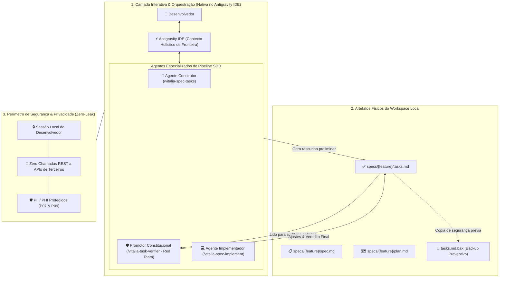
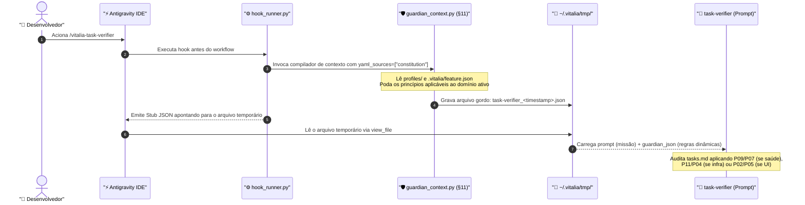
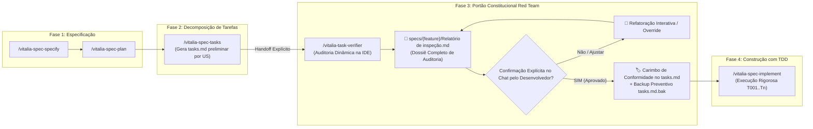
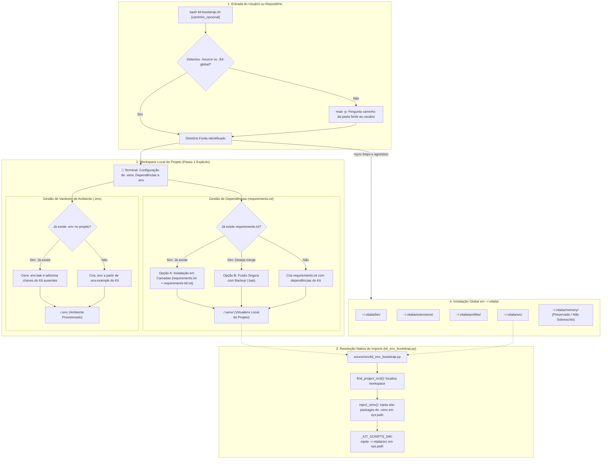

<!-- architecture-diagrams.md | Vitalia SDD v0.6.0 | 16-10-2026 14:49(GMT-04:00) -->
# Diagramas de Arquitetura: Task Verifier Workflow & Bootstrap Universal

**Data:** 16-10-2026 14:49(GMT-04:00)  
**Feature:** `task-verifier-workflow`  
**Documentos Relacionados:**
- [research-brainstorming.md](file:///home/andre/projetos/assistidos/kit_src/specs/task-verifier-workflow/research-brainstorming.md)
- [research.md](file:///home/andre/projetos/assistidos/kit_src/specs/task-verifier-workflow/research.md)
- [kit_judge_audit.md](file:///home/andre/projetos/assistidos/kit_src/specs/sdd-judge-distributed/kit_judge_audit.md)

---

## 1. Segregação de Camadas: Execução Nativa na IDE vs. Isolamento Local

Este diagrama demonstra a eliminação de chamadas REST para APIs externas avulsas e o isolamento de dados dentro da sessão autorizada da IDE, protegendo a cota de tokens e garantindo zero vazamento de PII/PHI.

---

## 2. Injeção Dinâmica de Regras Constitucionais via Context Lifting (§11)

Este diagrama detalha como o `task-verifier.toml` permanece 100% agnóstico e sem regras fixas no prompt, recebendo os princípios (P00-P17) dinamicamente podados pelo Guardião para a feature ativa.

---

## 3. Fluxo Ponta a Ponta: Da Concepção à Implementação

Este diagrama mostra o ciclo de vida SDD refinado, com o handoff explícito de `spec-tasks` para `task-verifier` antes de permitir qualquer escrita de código produtivo.

---

## 4. Arquitetura Universal de Bootstrap (`kit-bootstrap.sh`)

Este diagrama ilustra o fluxo de instalação: ele anuncia e gerencia explicitamente o `.venv` local com tratamento de colisão em `requirements.txt`, sincroniza os arquivos do Kit para `~/.vitalia/` e delega a resolução dinâmica de imports para o módulo canônico `kit_env_bootstrap.py`.

